# Лабораторная работа №3. Облачные сети. Amazon VPC

**ФИО:** Каварналы Анастасия  
**Группа:** IA2403  
**Специальность:** Прикладная информатика  
**Порядковый номер:** 12  
**Уровень:** Продвинутый  
**Репозиторий:** https://github.com/cavarnalia-cloud/timecapsule

# Часть 1. Базовый уровень

## Задание 1. План адресов

**Номер в группе:** 12  
**X = 12 mod 30 = 12**  
**Диапазон VPC:** `10.12.0.0/16`

| Подсеть | Зона доступности | Диапазон | Первый и последний доступный IP | Количество доступных IP |
|---|---|---|---|---|
| public-a | eu-central-1a | `10.12.0.0/24` | 10.12.0.4 – 10.12.0.254 | 251 |
| public-b | eu-central-1b | `10.12.1.0/24` | 10.12.1.4 – 10.12.1.254 | 251 |
| private-a | eu-central-1a | `10.12.10.0/24` | 10.12.10.4 – 10.12.10.254 | 251 |
| private-b | eu-central-1b | `10.12.11.0/24` | 10.12.11.4 – 10.12.11.254 | 251 |

### Ответ на вопрос

**Почему доступных адресов не 256? Какие адреса занимает AWS? Сколько ещё подсетей /24 поместится в VPC?**

В каждой подсети AWS резервирует пять IP-адресов: первый адрес сети, адрес маршрутизатора, адрес DNS, один резервный адрес и последний адрес подсети. Поэтому из 256 адресов доступны 251. В VPC с диапазоном `/16` помещается 256 подсетей `/24`. После создания четырёх подсетей остаётся место ещё для 252.

## Задание 2. VPC и подсети

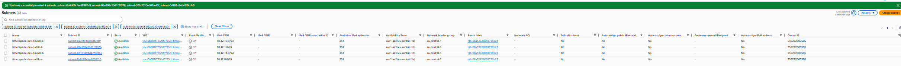

Рисунок 1 - Четыре подсети, созданные внутри VPC

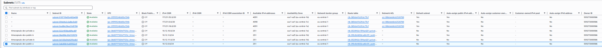

Рисунок 2 - Проверка созданных подсетей и автоматической выдачи публичных IPv4-адресов

### Ответ на вопрос

**Является ли подсеть public-a сейчас публичной? Почему?**

Нет, пока подсеть public-a не является публичной, потому что для неё ещё не настроен маршрут в интернет через Internet Gateway. Одного названия public-a недостаточно, чтобы подсеть стала публичной.

## Задание 3. Internet Gateway и таблицы маршрутов

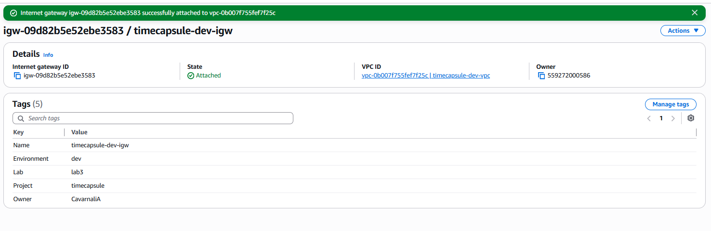

Рисунок 3 - Internet Gateway подключён к VPC

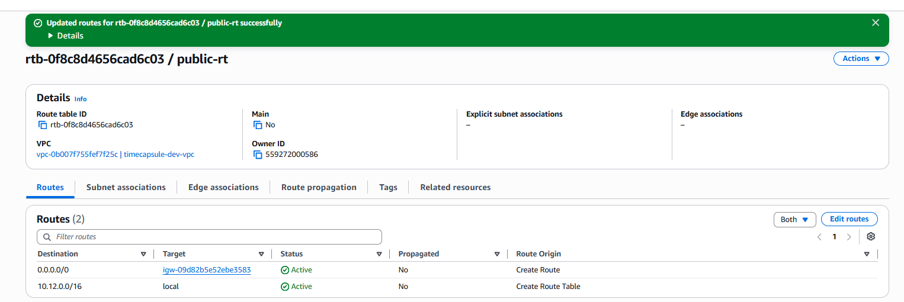

Рисунок 4 - Публичная таблица маршрутов с выходом в интернет через Internet Gateway

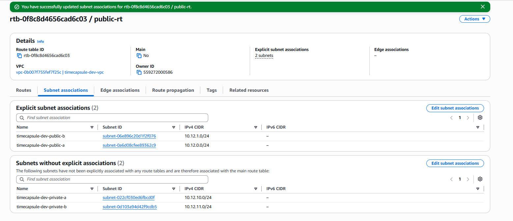

Рисунок 5 - Подключение публичных подсетей к таблице маршрутов

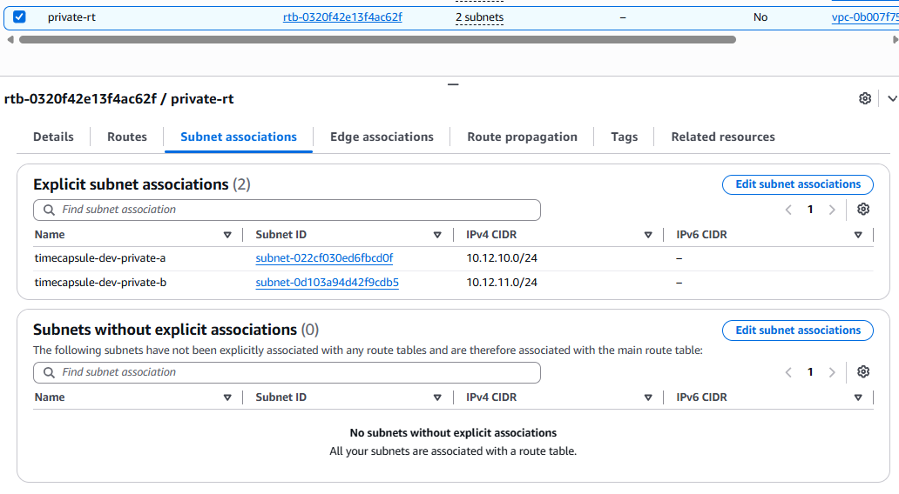

Рисунок 6 - Подключение приватных подсетей к таблице маршрутов

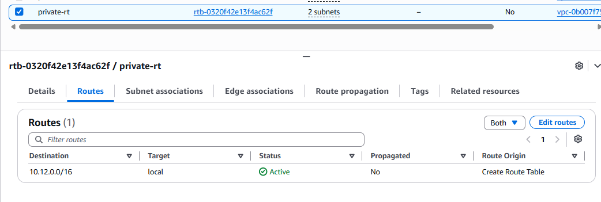

Рисунок 7 - Приватная таблица маршрутов без постоянного выхода в интернет

### Ответ на вопрос

**Какой маршрут есть в обеих таблицах, хотя вы его не добавляли? Что он даёт?**

Это маршрут 10.12.0.0/16 → local, который AWS добавляет автоматически. Он позволяет серверам внутри одной VPC обращаться друг к другу по приватным IP-адресам

**Куда уйдёт пакет из `private-a`, адресованный 8.8.8.8?**

Пакет не сможет выйти в интернет, потому что в приватной таблице нет подходящего маршрута для адреса 8.8.8.8. Для такого соединения нужно временно настроить выход через NAT Gateway

## Задание 4. Security Groups

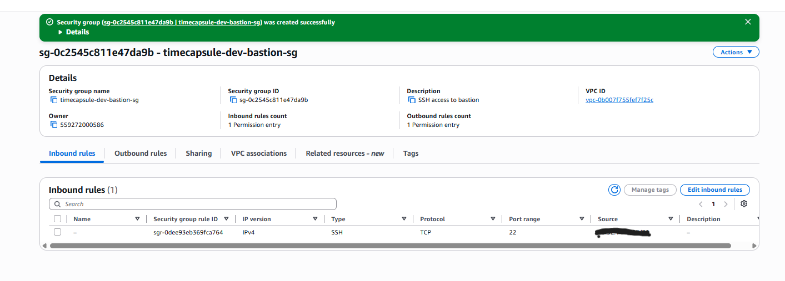

Рисунок 8 - Настройка правил SSH-доступа к Bastion

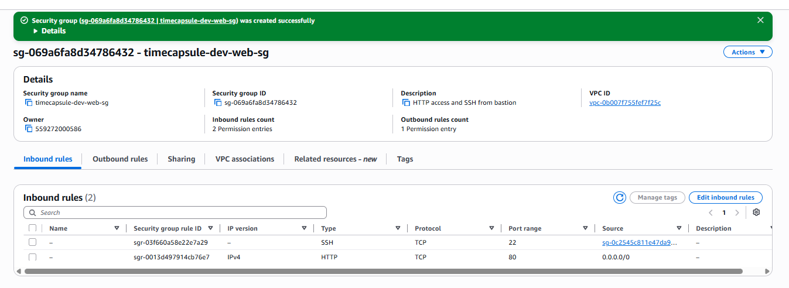

Рисунок 9 - Настройка правил доступа к веб-серверу

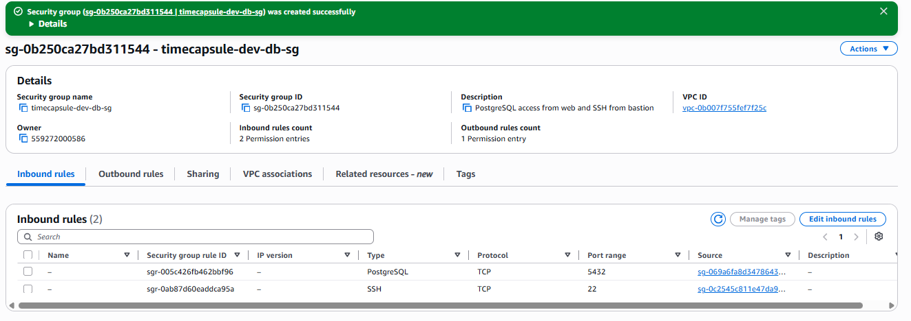

Рисунок 10 - Настройка правил доступа к PostgreSQL

### Ответ на вопрос

**Почему в db-sg источником указана группа web-sg, а не адрес веб-сервера или диапазон 10.12.0.0/16?**

Подключаться к PostgreSQL могут только серверы из группы web-sg. Если приватный IP приложения изменится, правило продолжит работать. Разрешать доступ всей VPC менее безопасно, потому что тогда к базе могли бы обращаться и другие серверы

## Задание 5. Экземпляры

Я создала три EC2-сервера:

- `timecapsule-dev-bastion` - для SSH-подключений;

- `timecapsule-dev-web` - для проверки работы веб-сервера на базовом этапе;

- `timecapsule-dev-db` - для PostgreSQL в приватной подсети.

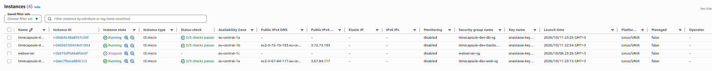

Рисунок 11 - Три созданных EC2-сервера

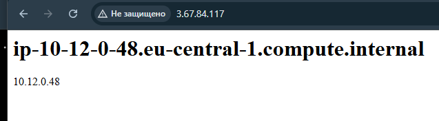

Рисунок 12 - Проверка работы веб-сервера в браузере

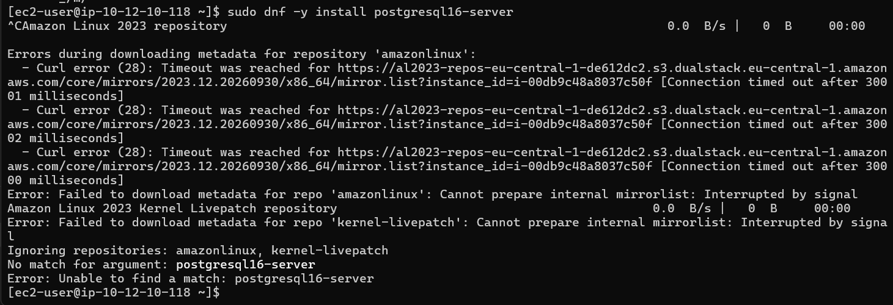

Рисунок 13 - Ошибка установки пакетов на приватном сервере без доступа к интернету

### Ответ на вопрос

**Почему db-server не может скачать пакеты, хотя web-server это делает? Что нужно добавить в сеть, чтобы db-server остался недоступным из интернета?**

Веб-сервер находится в публичной подсети, а сервер базы данных - в приватной. У базы нет прямого маршрута в интернет, поэтому загрузка пакетов не работает. Для обновлений можно использовать NAT Gateway, который позволяет серверу обращаться наружу, но не открывает входящий доступ из интернета.

## Задание 6. Временный NAT Gateway

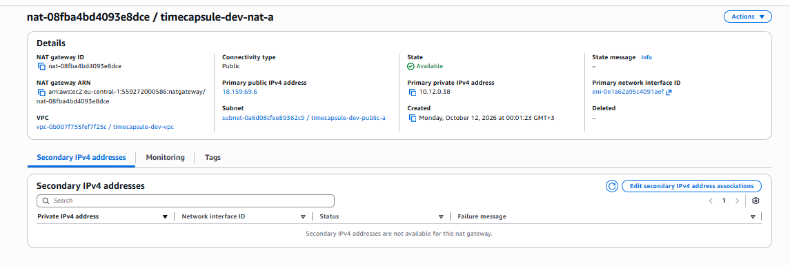

Рисунок 14 - Создание временного NAT Gateway

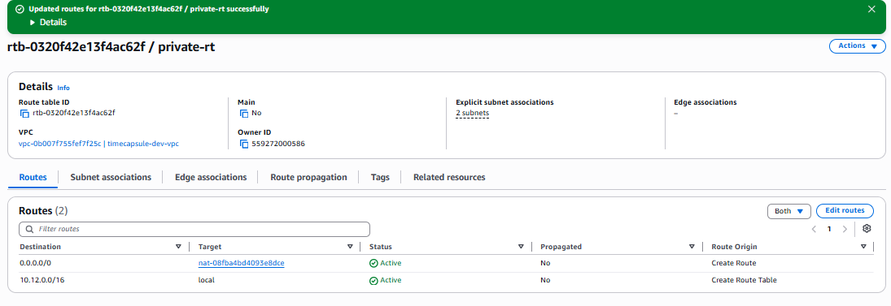

Рисунок 15 - Настройка маршрута приватной подсети через NAT Gateway

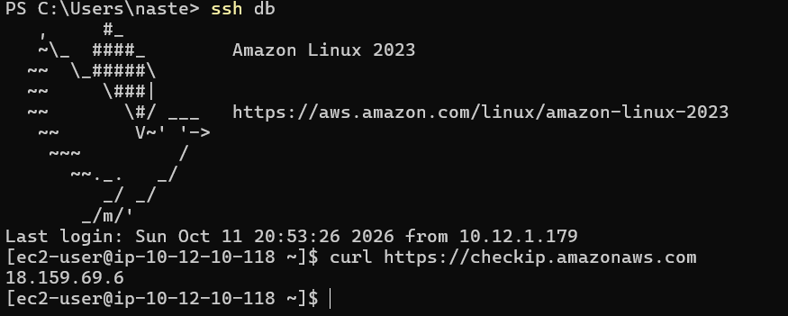

Рисунок 16 - Проверка выхода в интернет через NAT Gateway

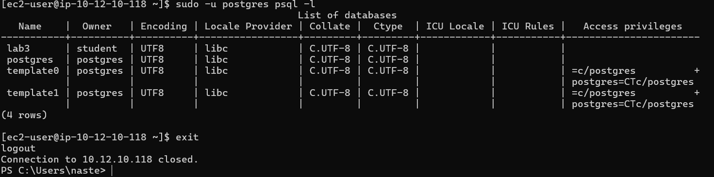

Рисунок 17 - Создание базы данных PostgreSQL

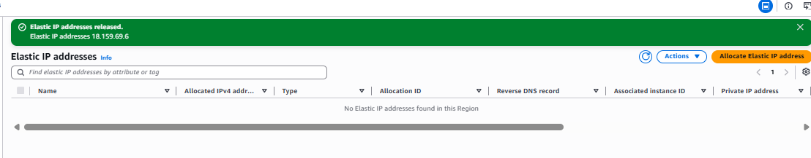

Рисунок 18 - Освобождение Elastic IP после удаления NAT Gateway

### Ответ на вопрос

**Какой адрес вернула первая команда? Сравните его с Elastic IP NAT Gateway. Почему PostgreSQL продолжает работать после удаления NAT Gateway?**

Команда `checkip` показала публичный IP-адрес NAT Gateway, поскольку сервер базы данных использует его для выхода в интернет. После удаления NAT Gateway PostgreSQL продолжает работать, так как приложение подключается к базе через внутреннюю сеть VPC, для которой доступ в интернет не требуется

## Задание 7. Проверки

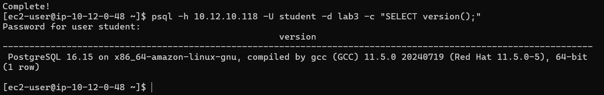

Рисунок 19 - Успешное подключение к PostgreSQL с веб-сервера

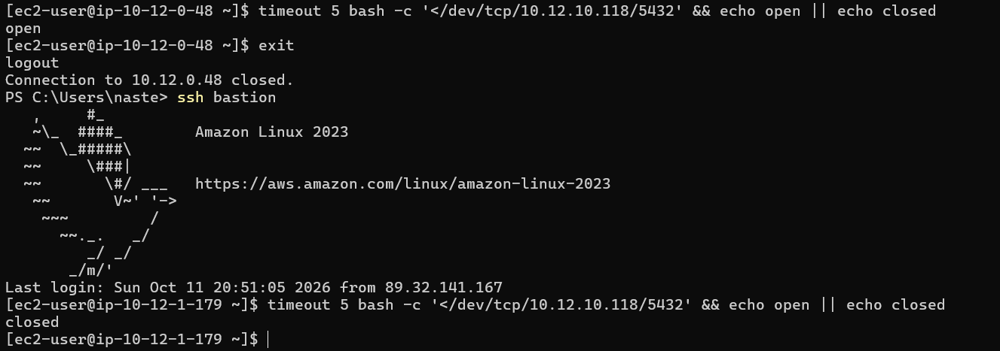

Рисунок 20 - Проверка доступности порта PostgreSQL

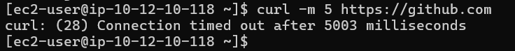

Рисунок 21 - Проверка отсутствия прямого доступа в интернет у базы данных

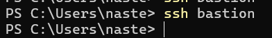

Рисунок 22 - Проверка блокировки SSH через Network ACL

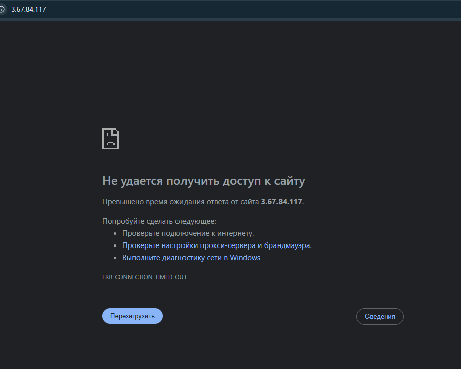

Рисунок 23 - Проверка блокировки сайта через Network ACL

Рисунок 24 - Проверка доступа к сайту через мобильный интернет

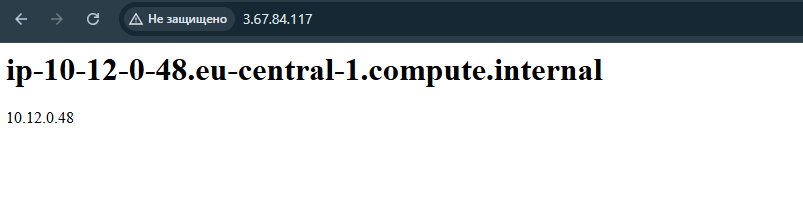

Рисунок 25 - Восстановление доступа после удаления запрещающего правила

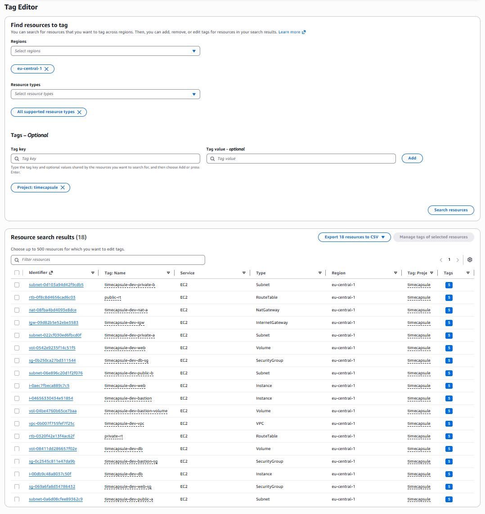

Рисунок 26 - Проверка тегов ресурсов проекта

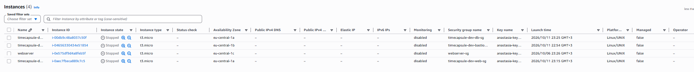

Рисунок 27 - Остановка трёх EC2-серверов после базовой части

# Часть 2. Продвинутый уровень

## Задание 8. Перенос сервера ЛР2 в новую сеть

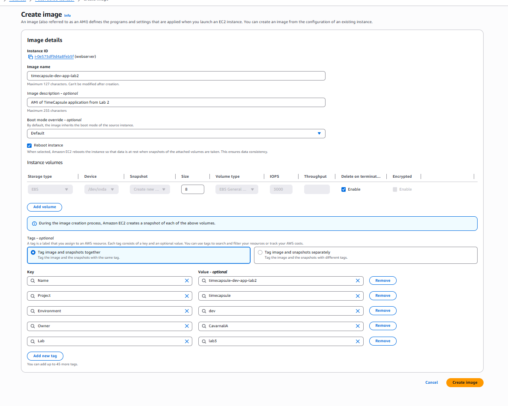

Рисунок 28 - Создание AMI старого сервера приложения

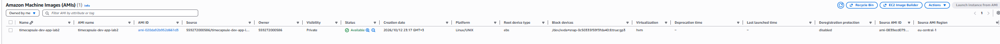

Рисунок 29 - Готовый AMI для переноса приложения

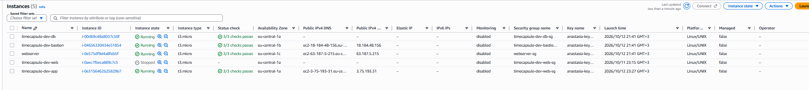

Рисунок 30 - Новый сервер приложения запущен в созданной VPC

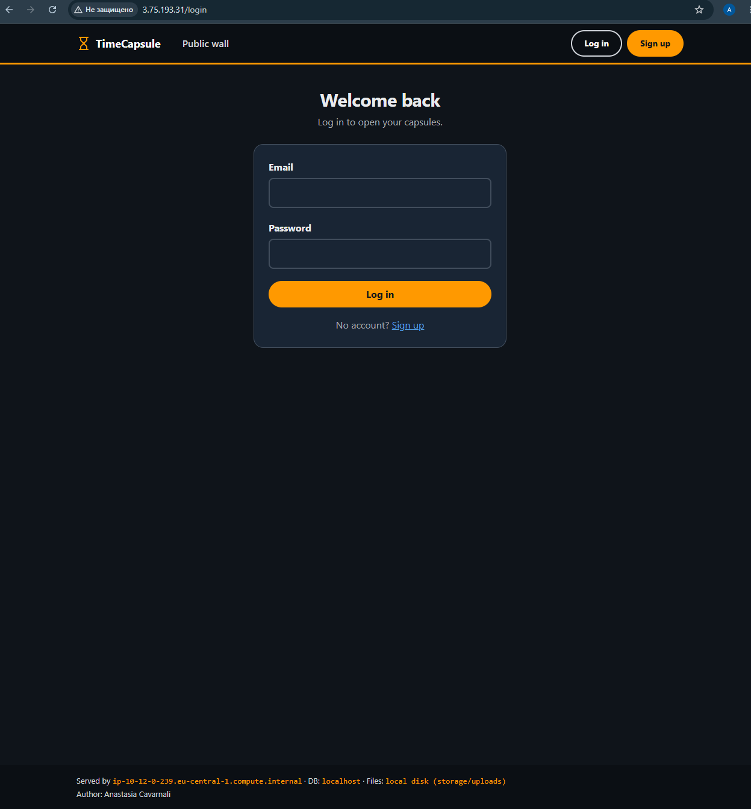

Рисунок 31 - Проверка работы TimeCapsule после переноса

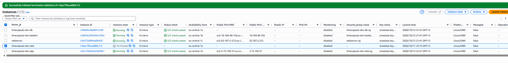

Рисунок 32 - Завершение работы временного веб-сервера

### Ответ на вопрос

**Что содержит образ? Какие данные из ЛР2 оказались на app-server без всякой установки? Где сейчас хранится база данных приложения?**

Образ AMI содержит операционную систему, установленные программы, настройки и файлы приложения. Поэтому на app-server из ЛР2 перенеслись TimeCapsule, Nginx, PHP, PostgreSQL и сохранённые данные без повторной установки. На данном этапе база данных всё ещё находится локально на app-server, а в следующих заданиях она будет перенесена на отдельный сервер db-server.

## Задание 9. Elastic IP

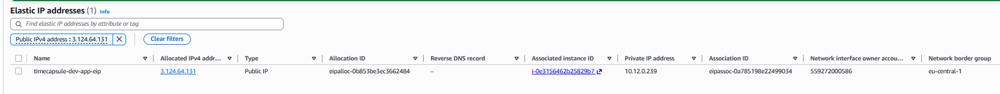

Рисунок 33 - Привязка Elastic IP к серверу приложения

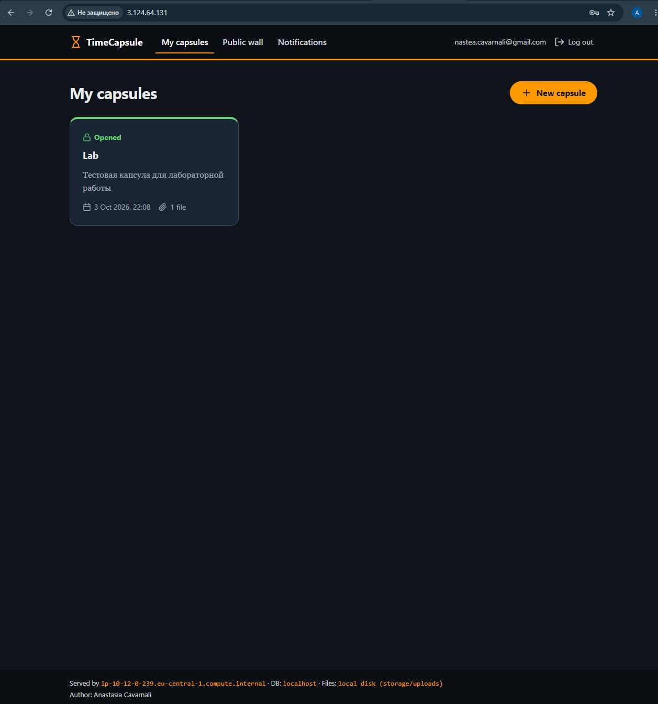

Рисунок 34 - Страница входа в TimeCapsule через постоянный публичный IP

### Ответ на вопрос

**1) Почему Elastic IP нужен `app-server`, но не нужен Bastion? 2) Сколько стоит Elastic IP, пока сервер остановлен, и почему? 3) Когда в следующих работах перед сервером появится балансировщик нагрузки, понадобится ли Elastic IP?**

1) Пользователи должны открывать сайт по постоянному адресу, поэтому приложению нужен Elastic IP. Bastion используется только для администрирования, и его публичный адрес можно обновлять в SSH-настройках после перезапуска. 

2) AWS взимает плату за публичные IPv4-адреса, в том числе когда сервер остановлен. Точная сумма зависит от действующих тарифов и времени использования. Поэтому такие адреса нужно учитывать даже после остановки EC2.

3) Обычно пользователи будут подключаться к балансировщику, а не напрямую к серверу приложения. Поэтому отдельный Elastic IP для app-server может больше не понадобиться. Вместо него можно использовать DNS-имя балансировщика.

## Задание 10. База данных приложения на `db-server`

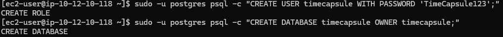

Рисунок 35 - Создание базы данных и пользователя PostgreSQL

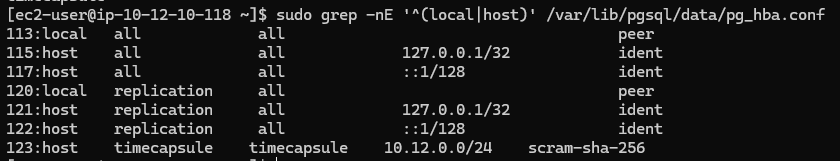

Рисунок 36 - Настройка правил подключения к PostgreSQL

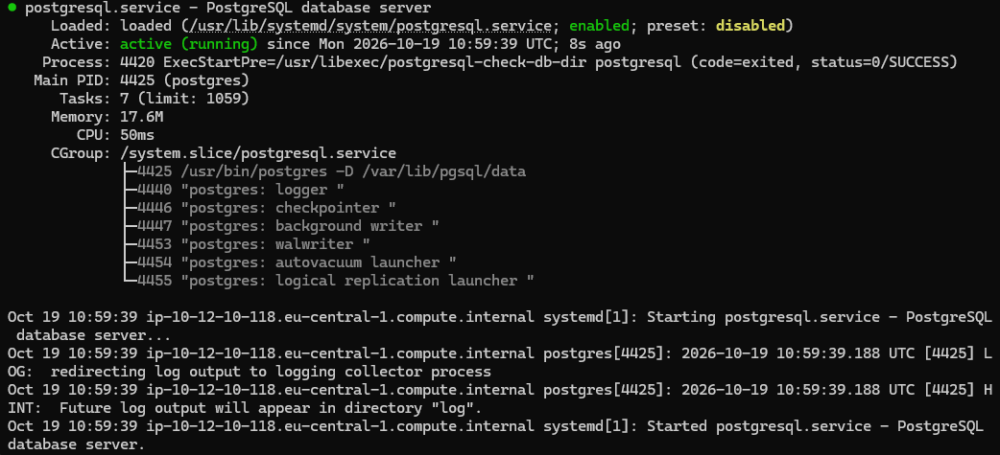

Рисунок 37 - Проверка состояния службы PostgreSQL

### Ответ на вопрос

**Зачем для базы в отдельной сети нужен новый сильный пароль, если порт 5432 и так закрыт Security Group?**

Security Group защищает соединение на сетевом уровне, но не заменяет пароль пользователя базы данных. Если кто-то получит доступ к разрешённому серверу, он всё равно должен пройти авторизацию в PostgreSQL. Поэтому сильный пароль нужен как дополнительная защита.

## Задание 11. Приватная зона Route 53

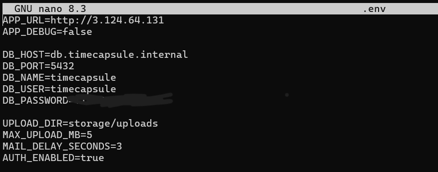

Рисунок 38 - Настройка подключения к базе данных через приватное DNS-имя

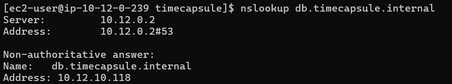

Рисунок 39 - Успешная проверка DNS-имени базы данных на app-server

### Ответ на вопрос

**Почему с app-server имя находится, а с вашего компьютера нет? Что придётся изменить, если db-server пересоздадут с другим адресом?**

Приватная DNS-зона Route 53 доступна внутри связанной с ней VPC. Поэтому сервер приложения может определить адрес `db.timecapsule.internal`, а домашний компьютер через обычный интернет - нет. Нужно будет изменить IP-адрес в DNS-записи Route 53. Приложение сможет продолжить использовать прежнее имя базы данных, если остальные настройки подключения останутся правильными.

## Задание 12. Перенос данных и переключение приложения

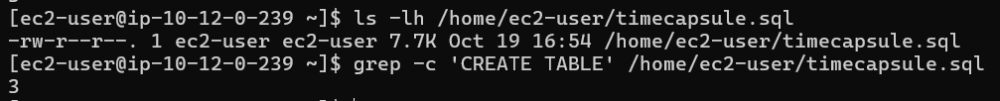

Рисунок 40 - Создание резервной копии базы данных TimeCapsule

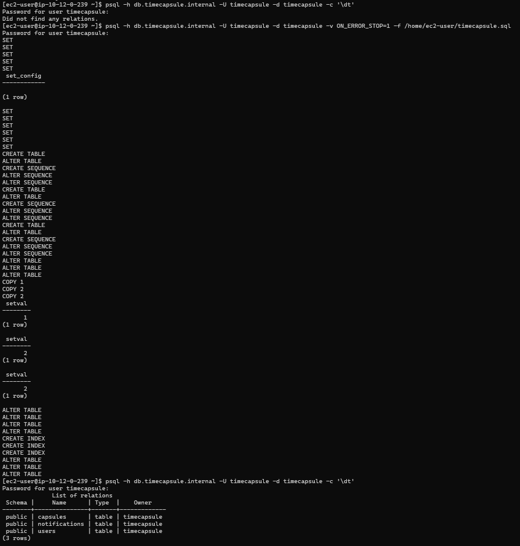

Рисунок 41 - Импорт данных в PostgreSQL на отдельном сервере

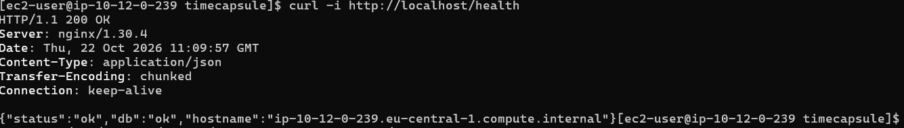

Рисунок 42 - Проверка подключения приложения к удалённой базе

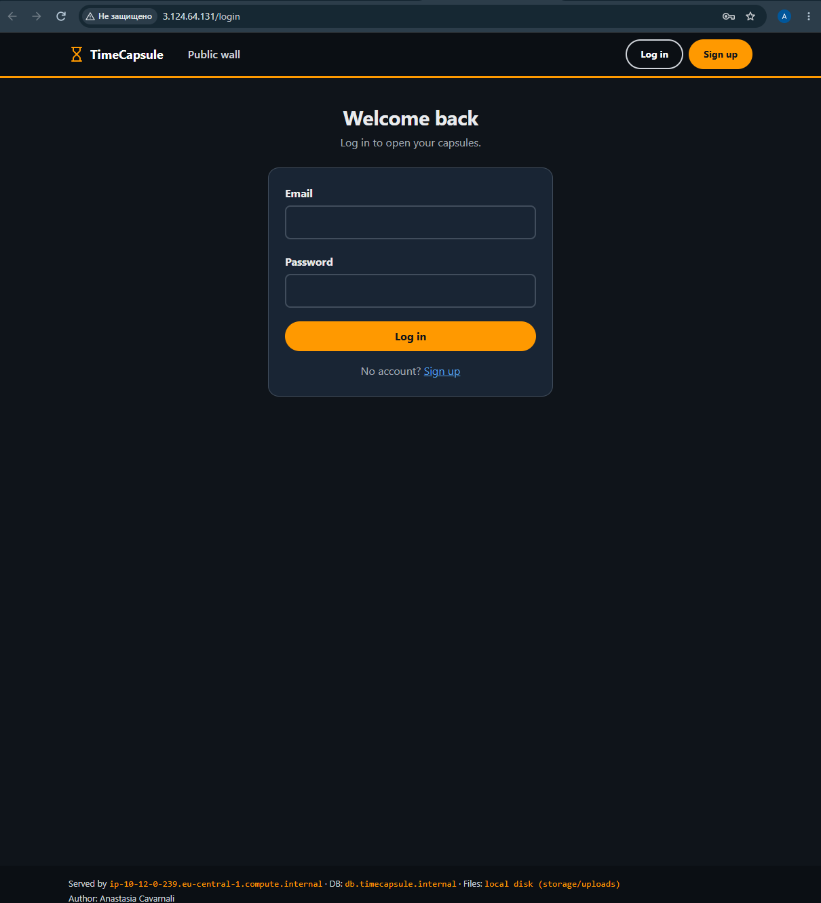

Рисунок 43 - Проверка сохранённых капсул после переноса данных

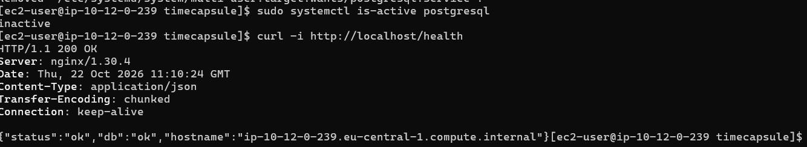

Рисунок 44 - Остановка локальной базы PostgreSQL на сервере приложения

### Ответ на вопрос

**Файлы, которые пользователи прикрепили к капсулам, переехали вместе с образом, а не вместе с базой. Где они лежат? Что с ними будет, если `app-server` удалить?**

Они находятся в каталоге загрузок на диске сервера приложения. SQL-файл содержит данные PostgreSQL, но не переносит сами прикреплённые файлы. Если удалить сервер вместе с диском, на котором хранятся вложения, файлы могут быть потеряны. Поэтому перед удалением сервера нужно перенести вложения в отдельное хранилище или сохранить резервную копию.

## Задание 13. Деплой и обслуживание

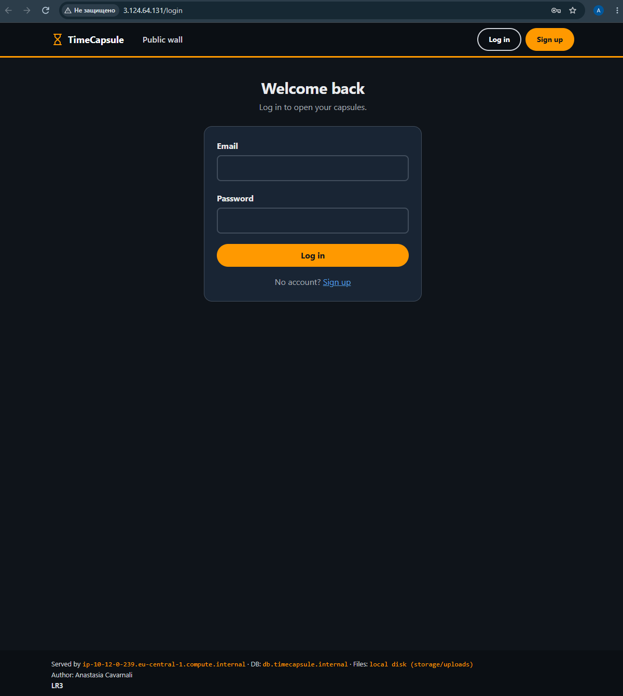

Рисунок 45 - Новая версия TimeCapsule с надписью LR3

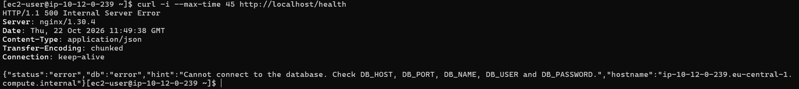

Рисунок 46 - Проверка /health при остановленной базе данных

### Ответ на вопрос

**Почему команды ручного деплоя не пришлось менять?**

Потому что изменился только способ SSH-подключения к серверу через Bastion. Сам процесс обновления остался прежним: получить новую версию кода из GitHub и проверить работу приложения. SSH-конфигурация позволяет обращаться к серверу по короткому имени app.

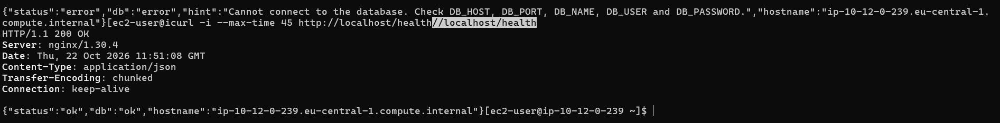

Рисунок 47 - Восстановление подключения к базе после запуска сервера

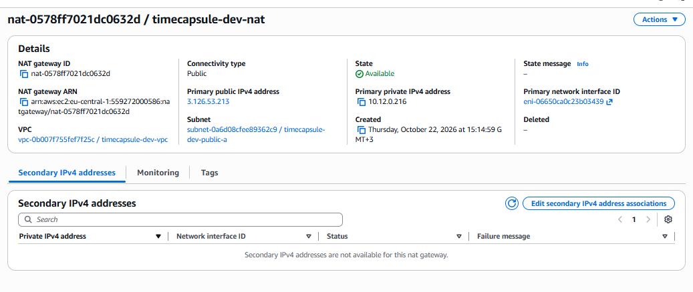

Рисунок 48 - Повторное создание временного NAT Gateway

### Ответ на вопрос

**Что показал `/health` и почему? Изменился ли приватный адрес db-server после остановки и запуска?**

При остановленной базе проверка `/health` не смогла подтвердить подключение к PostgreSQL. Это произошло потому, что сервер приложения продолжал работать, но база данных была недоступна.
Нет, у существующего EC2-сервера сохранился приватный IP 10.12.10.118. Поэтому после запуска базы приложение снова смогло подключиться без изменения DNS-записи и настроек.

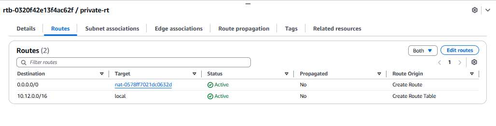

Рисунок 49 - Настройка маршрута для обновления приватного сервера

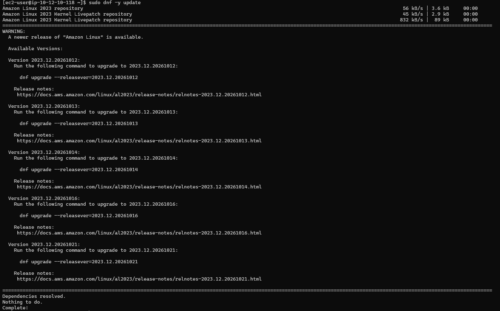

Рисунок 50 - Установка обновлений на сервере базы данных

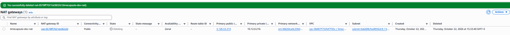

Рисунок 51 - Удаление NAT Gateway после обновлений

### Ответ на вопрос

**Почему nat-down.sh должен освобождать Elastic IP только после того, как NAT Gateway удалён?**

Скрипт `nat-down.sh` должен сначала удалить NAT Gateway, потому что Elastic IP ещё привязан к нему. После полного удаления шлюза IP-адрес можно освободить, чтобы он не оставался занятым и за него не начислялась лишняя плата.

## Задание 14. Архитектура и решение

Рисунок 52 - Архитектура приложения TimeCapsule в Amazon VPC

# Контрольные вопросы

## 1. Как проходит запрос пользователя от браузера до базы данных? Какие маршруты и какие правила фильтрации он проходит на каждом шаге?

Когда пользователь открывает TimeCapsule, запрос через интернет и Internet Gateway поступает на сервер приложения. Таблица маршрутов и Security Group разрешают HTTP-подключение к веб-серверу. Если приложению нужны данные, оно обращается к PostgreSQL по приватному адресу через локальный маршрут VPC и разрешённый порт 5432. Затем приложение получает данные из базы и отправляет ответ пользователю.

## 2. Злоумышленник знает приватный IP `db-server`. Что ему нужно получить, чтобы подключиться к базе?

Одного приватного IP-адреса недостаточно, потому что сервер базы данных недоступен напрямую из интернета. Злоумышленнику нужен доступ к сети или серверу, с которого разрешены подключения к PostgreSQL. Кроме этого, необходимо пройти проверку учётных данных базы данных. Поэтому важно защищать и сетевые правила, и пароли.

## 3. Чем временный NAT Gateway лучше постоянного и какие неудобства он создаёт?

Временный NAT Gateway позволяет подключать приватный сервер к интернету только тогда, когда это необходимо. Например, его можно использовать для установки обновлений, а затем удалить и не оплачивать постоянно. Недостаток в том, что перед следующим обновлением шлюз и маршрут нужно создавать заново. Это занимает дополнительное время.

## 4. Как изменится схема, если приложение должно пережить отказ зоны `eu-central-1a`? Каких ресурсов для этого не хватает?

Сейчас приложение и база данных расположены в зоне `eu-central-1a`, поэтому при её отказе сайт может перестать работать. Для повышения надёжности нужно добавить сервер приложения в другую зону доступности и использовать балансировщик нагрузки. Также потребуется резервная база данных в другой зоне с возможностью переключения. Тогда система сможет продолжить работу при отказе одной зоны.
