# Лабораторная работа №4. Облачные сети. Amazon VPC

**ФИО:** Каварналы Анастасия  
**Группа:** IA2403  
**Специальность:** Прикладная информатика  
**Уровень:** Продвинутый  
**Репозиторий:** https://github.com/cavarnalia-cloud/timecapsule

# Часть 1. Базовый уровень

## Задание 1. Бакет и объекты в консоли

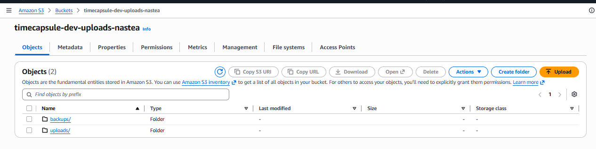

Рисунок 1 - Созданный бакет с папками uploads и backups

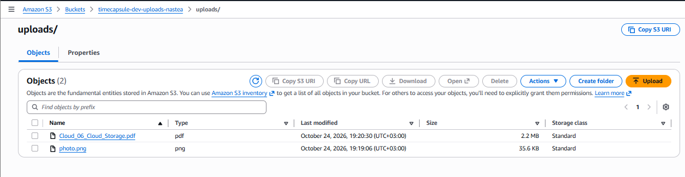

Рисунок 2 - Изображение и PDF-файл в папке uploads

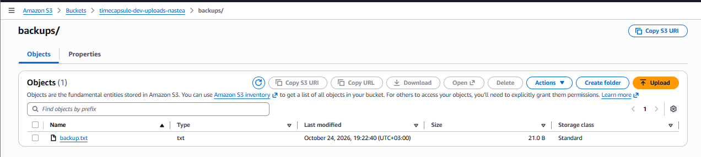

Рисунок 3 - Текстовый файл в папке backups

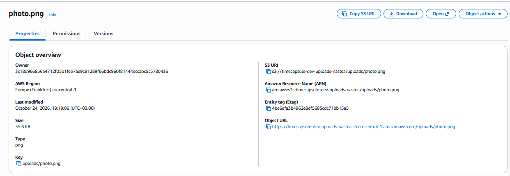

Рисунок 4 - Свойства изображения: Key, ETag и Object URL

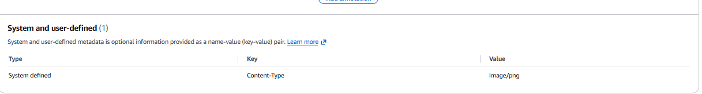

Рисунок 5 - Проверка Content-Type изображения

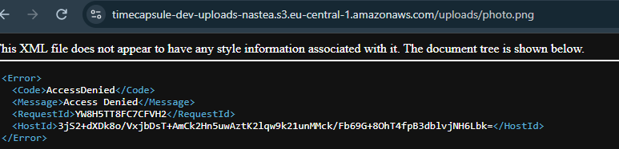

Рисунок 6 - Ошибка AccessDenied при открытии Object URL

### Ответ на вопрос

**Какой ключ у картинки? Почему `Object URL` не открывается, хотя вы владелец бакета? Что на самом деле создала кнопка `Create folder`?**

Ключ изображения - uploads/photo.png. Бакет закрыт для публичного доступа. Обычная ссылка не передаёт AWS-авторизацию, поэтому S3 возвращает AccessDenied. Кнопка создала объект с ключом, заканчивающимся на /. В S3 папки являются логической группировкой объектов по префиксу.

## Задание 2. Объекты из командной строки

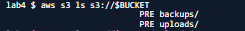

Рисунок 7 - Просмотр содержимого бакета через AWS CLI

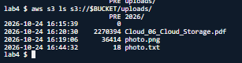

Рисунок 8 - Просмотр объектов папки uploads

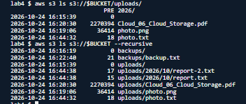

Рисунок 9 - Рекурсивный просмотр объектов бакета

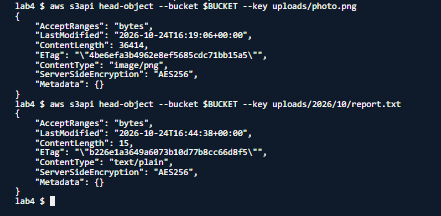

Рисунок 10 - Проверка метаданных объектов командой head-object

### Ответ на вопрос

**Почему первая команда `ls` показывает `PRE uploads/` и `PRE backups/`, а третья показывает полные ключи? Какой `Content-Type` получил `report.txt`, хотя вы его не указывали?**

Обычная команда группирует объекты по префиксам. Параметр `--recursive` выводит все объекты с полными ключами без группировки. Файл получил тип text/plain, поскольку AWS CLI автоматически определяет MIME-тип по расширению.

## Задание 3. Политика бакета: только HTTPS

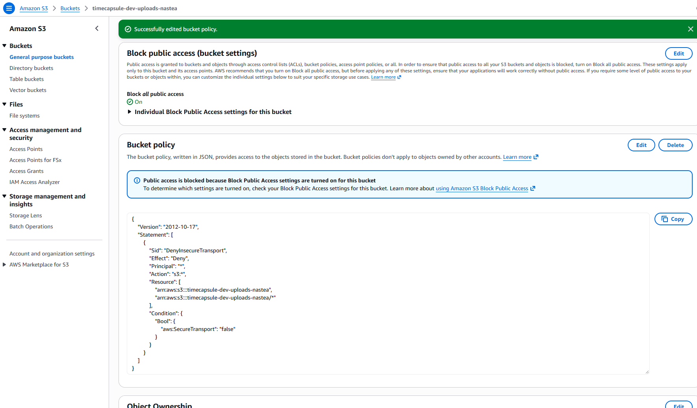

Рисунок 11 - Политика бакета с запретом HTTP-запросов

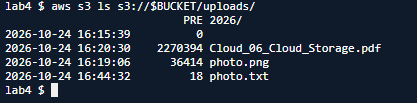

Рисунок 12 - Успешный доступ к S3 через HTTPS

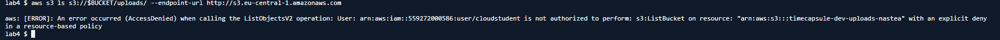

Рисунок 13 - Ошибка AccessDenied при обращении через HTTP

### Ответ на вопрос

**Почему вторая команда получает `AccessDenied`, хотя у вас права администратора? Почему Block Public Access не помешал сохранить политику с `"Principal": "*"`?**

Политика бакета содержит явный запрет Deny для HTTP-запросов. Явный запрет имеет приоритет над разрешениями администратора. Политика не открывает публичный доступ, а запрещает небезопасные запросы для всех пользователей.

## Задание 4. Версионирование и защита от удаления

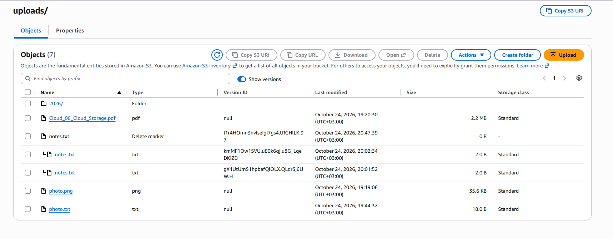

Рисунок 14 - Версии notes.txt и Delete marker после удаления объекта

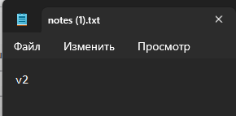

Рисунок 15 - Содержимое версии v2 файла notes.txt

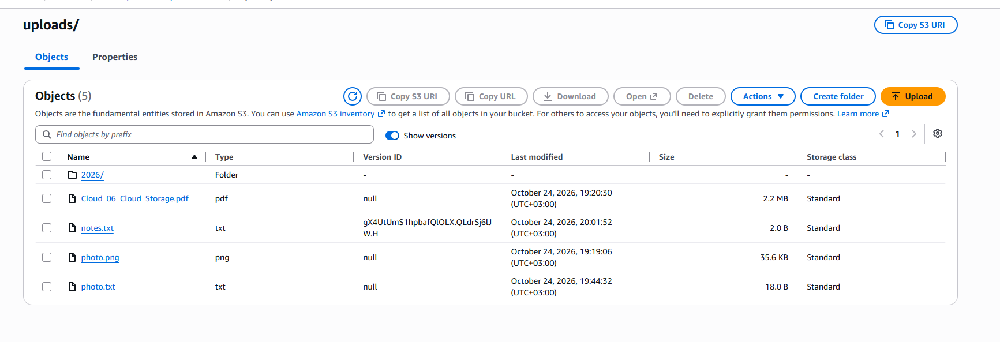

Рисунок 16 - Откат файла notes.txt к версии v1

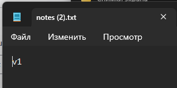

Рисунок 17 - Проверка содержимого восстановленной версии v1

### Ответ на вопрос

**Чем удаление в шаге 3 отличается от удаления в шаге 5? Какое из них можно отменить? Какой из двух способов защищает от случайного удаления, а какой нужно запрещать приложению?**

Обычное удаление создаёт Delete marker, сохраняя предыдущие версии. Удаление конкретной версии окончательно удаляет её данные. Обычное удаление можно отменить, удалив Delete marker. Версионирование защищает от случайного удаления и перезаписи. Приложению нужно запретить s3:DeleteObjectVersion, чтобы оно не могло окончательно удалять версии.

## Задание 5. Правило жизненного цикла

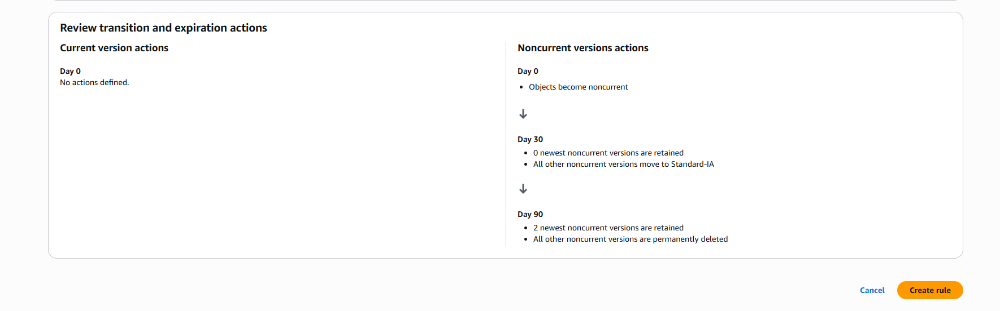

Рисунок 18 - Правило Lifecycle для перехода и удаления старых версий объектов

## Ответ на вопрос

**Как поведёт себя правило для файла, который перезаписывали 10 раз за неделю? Какие версии и когда окажутся в Standard-IA, какие будут удалены? Почему наши маленькие тестовые файлы в Standard-IA не попадут? Что такое незавершённая загрузка частями и почему за неё приходится платить?**

S3 сохранит текущую и девять старых версий. Через 30 дней после перехода в неактуальное состояние подходящие версии будут перенесены в Standard-IA. Через 90 дней старые версии будут удаляться, кроме двух самых новых неактуальных версий. По умолчанию Lifecycle не переводит объекты размером менее 128 КБ в другой класс хранения. Это загрузка файла по частям, которая не была завершена. Загруженные части продолжают занимать место в S3, поэтому за их хранение может начисляться плата.

## Задание 6. Подписанные URL

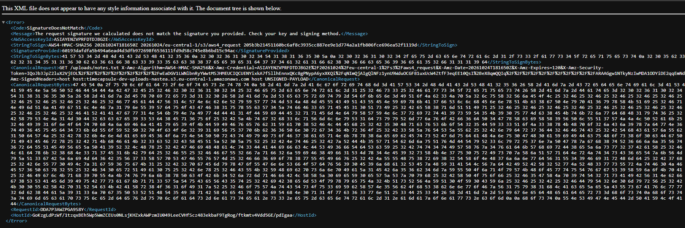

Рисунок 19 - Ошибка SignatureDoesNotMatch после изменения подписанного URL

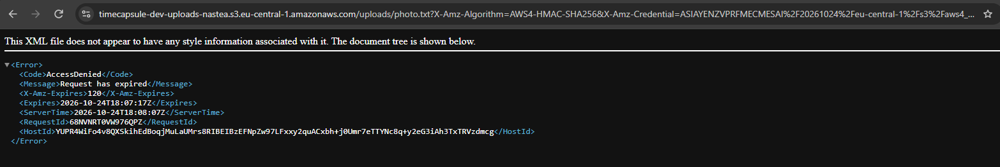

Рисунок 20 - Ошибка AccessDenied после истечения срока действия ссылки

## Ответ на вопрос

**Какие ошибки вернул S3 в шагах 3 и 4? Почему нельзя получить другой файл, просто поменяв ключ в ссылке? Обращалась ли команда `aws s3 presign` к S3, когда создавала ссылку?**

Изменённая ссылка вернула `SignatureDoesNotMatch`, а просроченная - `AccessDenied` с сообщением `Request has expired`. Подпись создаётся для конкретного объекта. Изменение ключа делает подпись недействительной. Нет, не обращалась. AWS CLI формирует подписанный URL локально с использованием доступных учётных данных.

# Часть 2. Продвинутый уровень

## Задание 7. Политика приложения

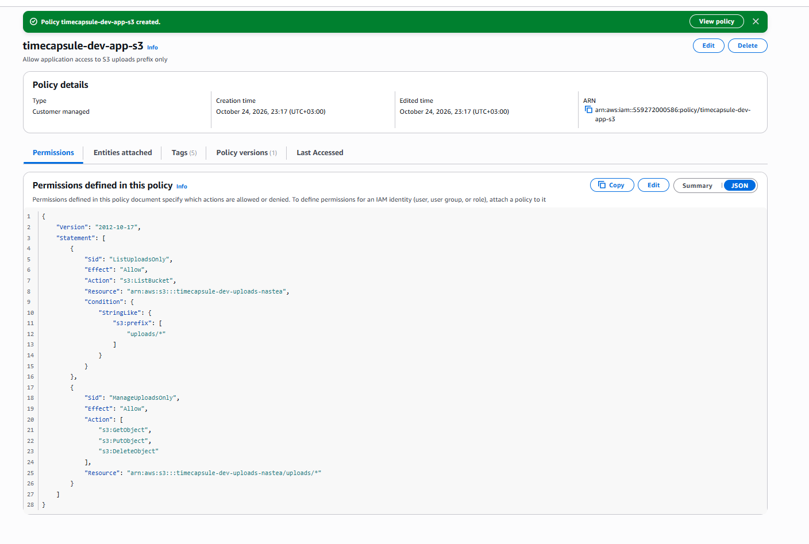

Рисунок 21 - IAM-политика приложения с доступом только к uploads

## Ответ на вопрос

**Почему `s3:ListBucket` относится к ресурсу "бакет", а `s3:GetObject` к ресурсу "объект"? Что произойдёт, если перепутать ARN в этих двух правилах?**

ListBucket получает список объектов бакета, поэтому использует ARN бакета. GetObject читает конкретный файл, поэтому использует ARN объекта. Разрешения не будут соответствовать нужным ресурсам, и запросы могут получить AccessDenied.

## Задание 8. Проверка прав через тестовую роль

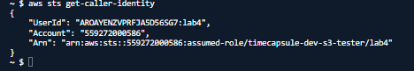

Рисунок 22 - Проверка тестовой IAM-роли через aws sts get-caller-identity

Рисунок 23 - Проверка разрешённых и запрещённых операций с Amazon S3

### Таблица проверки прав

| № | Команда | Ожидаю | Получил | Какое правило сработало |
|---|---|---|---|---|
| 1 | `aws s3 cp test.txt s3://$BUCKET/uploads/test.txt` | Разрешено | Разрешено | Разрешение приложения |
| 2 | `aws s3 ls s3://$BUCKET/uploads/` | Разрешено | Разрешено | Разрешение приложения |
| 3 | `aws s3 ls s3://$BUCKET` | AccessDenied | AccessDenied | Неявный запрет |
| 4 | `aws s3 cp s3://$BUCKET/uploads/photo.txt -` | Разрешено | Разрешено | Разрешение приложения |
| 5 | `aws s3 ls s3://$BUCKET/backups/`  | AccessDenied | AccessDenied | Неявный запрет |
| 6 | `aws s3 cp test.txt s3://$BUCKET/backups/test.txt` | AccessDenied | AccessDenied | Неявный запрет |
| 7 | `aws s3api list-object-versions --bucket $BUCKET --prefix uploads/`  | AccessDenied | AccessDenied | Неявный запрет |
| 8 | `aws s3api delete-object --bucket $BUCKET --key uploads/test.txt --version-id <VersionId>` | AccessDenied | AccessDenied | Неявный запрет |
| 9 | `aws s3 rm s3://$BUCKET/uploads/test.txt`  | Разрешено | Разрешено | Разрешение приложения |
| 10 | `aws s3 ls s3://$BUCKET/uploads/ --endpoint-url http://s3.eu-central-1.amazonaws.com` | AccessDenied | AccessDenied | Явный запрет бакета |

## Ответ на вопрос

**Чем политика доверия роли отличается от политики прав? Что на самом деле произошло с `test.txt` после команды 9, и можно ли его восстановить? Сможет ли злоумышленник, получивший учётные данные приложения, уничтожить файлы пользователей без возможности восстановления? А если бы в политике было `"s3:*"`**

Политика доверия определяет, кто может принять роль. Политика прав определяет, какие действия разрешены этой роли. Был создан Delete marker, а предыдущая версия файла сохранилась. Файл можно восстановить, удалив маркер. С текущими правами он не может окончательно удалять отдельные версии. При разрешении s3:* на соответствующие ресурсы он мог бы получить такую возможность.

## Задание 9. Роль сервера

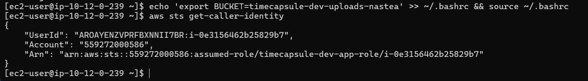

Рисунок 24 - Проверка IAM-роли на EC2-сервере приложения

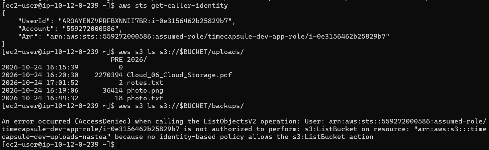

Рисунок 25 - Проверка разрешённого доступа к uploads и запрета доступа к backups

## Ответ на вопрос

**Где AWS CLI на сервере взял учётные данные, если вы не выполняли `aws configure` и не вызывали `assume-role`? Чем политика доверия этой роли отличается от тестовой? Почему такие учётные данные безопаснее ключа доступа в файле `.env`**

AWS CLI автоматически получил временные учётные данные IAM-роли через Instance Metadata Service экземпляра EC2. Серверную роль может принимать сервис EC2, а тестовая роль предназначена для принятия пользователем AWS. Временные учётные данные автоматически обновляются и не требуют хранения постоянных AWS-ключей в файлах приложения.

## Задание 10. Перенос существующих файлов

Рисунок 26 - Успешная синхронизация локальных вложений с Amazon S3

Рисунок 27 - Повторная проверка синхронизации без новых файлов для загрузки

## Ответ на вопрос

**Хватило ли для `aws s3 sync` прав политики приложения? Какие из разрешённых действий использовала команда?**

Да, синхронизация прошла успешно. Для проверки объектов использовалось разрешение `s3:ListBucket`, а для загрузки файлов - `s3:PutObject`.

## Задание 11. Модуль хранения на S3

Ссылка на изменения кода:

https://github.com/cavarnalia-cloud/timecapsule/commit/d8d1fc6

В коммите изменены пять файлов: `.env.example`, `composer.json`, `composer.lock`, `src/storage.php` и `views/layout.php`.

В модуле `src/storage.php` функции загрузки, удаления и скачивания файлов переведены на Amazon S3. Для скачивания используется подписанный URL сроком 5 минут.

## Задание 12. Деплой и проверка

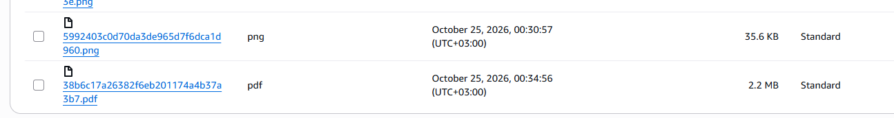

Рисунок 28 - Новые изображения PNG и PDF, загруженные приложением в S3

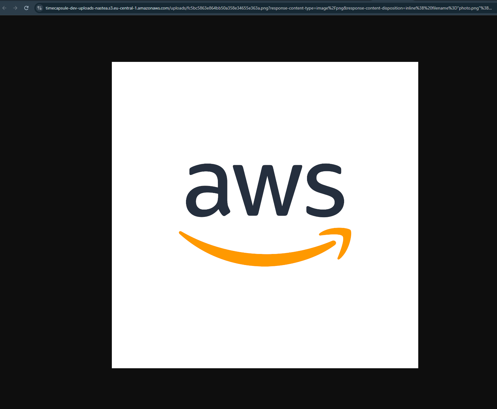

Рисунок 29 - Открытие вложения через подписанный URL Amazon S3

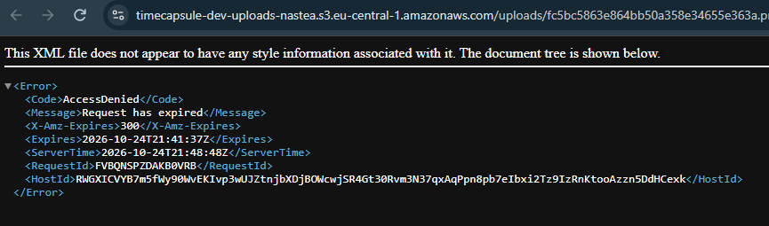

Рисунок 30 - Ошибка AccessDenied после истечения срока действия ссылки

## Ответ на вопрос

**Почему ссылку, которую пользователь переслал другу, не нужно специально отзывать? Что осталось в бакете после удаления капсулы и когда это исчезнет окончательно?**

Она действует ограниченное время. После истечения пяти минут S3 автоматически запрещает доступ по этой ссылке. После удаления появился Delete marker, а предыдущая версия объекта сохранилась. Lifecycle может удалять старые версии после 90 дней, но две самые новые неактуальные версии остаются, поэтому окончательное удаление не гарантируется через 90 дней.

## Задание 13. Сервер без состояния

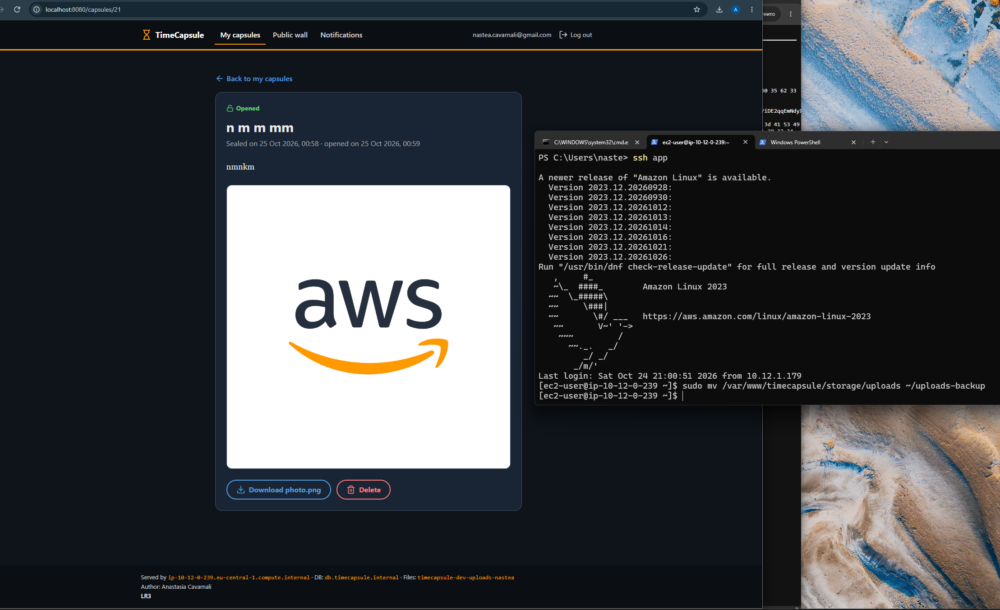

Рисунок 31 - Работа TimeCapsule после удаления локального каталога uploads

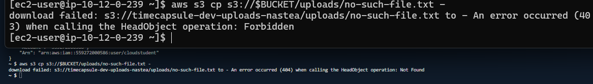

Рисунок 32 - Ответ 403 Forbidden на app-server и 404 Not Found в CloudShell

## Ответ на вопрос

**Почему S3 ответил вам и серверу по-разному, хотя объекта нет в обоих случаях? Зачем S3 так поступает? Что теперь нужно сделать, чтобы заменить app-server новым сервером без потери данных?**

Серверная роль не имеет `s3:ListBucket`, поэтому получает 403. Пользователь с правом просмотра бакета получает 404, поскольку объект отсутствует. Это предотвращает раскрытие информации о существовании объектов пользователям без достаточных разрешений. Нужно развернуть приложение на новом сервере, назначить IAM-роль, настроить доступ к базе данных и S3. Копировать вложения с прежнего EC2 больше не требуется.

## Задание 14. Архитектура и решение

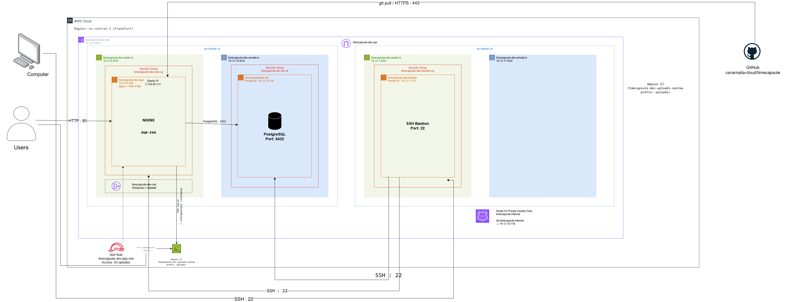

Рисунок 33 - Архитектура TimeCapsule с Amazon S3 и IAM-ролью сервера

### ADR

[Решение о хранении вложений](../adr/0003-attachment-storage.md)

# Контрольные вопросы

## 1. Как проходит запрос на скачивание вложения: от нажатия ссылки в браузере до получения файла? Где на этом пути проверяются права пользователя приложения, а где права роли?

Пользователь нажимает на вложение в TimeCapsule. Приложение проверяет его права доступа к капсуле и создаёт подписанный URL с помощью IAM-роли. Браузер получает перенаправление HTTP 302 и скачивает файл напрямую из S3. S3 проверяет подпись и срок её действия.

## 2. Какие настройки бакета и какие свойства подписанного URL не дают постороннему открыть вложение по прямому адресу объекта?

В бакете включён Block Public Access, а доступ к объектам ограничен IAM-политиками. Обычная ссылка не содержит авторизации. Подписанный URL позволяет временно получить конкретный объект, поскольку содержит действительную подпись.

## 3. Почему приложение отдаёт файлы через подписанный URL, а не открывает бакет для чтения всем?

Так вложения остаются закрытыми. Приложение сначала проверяет права пользователя и только затем выдаёт временную ссылку. Открывать весь бакет для публичного чтения не требуется.

## 4. Как изменится схема, если вложения должны пережить отказ всего региона `eu-central-1`?

Понадобится репликация объектов S3 в бакет другого региона и возможность переключения приложения на резервный регион. Также нужно предусмотреть восстановление приложения и базы данных в другом регионе, чтобы вся система оставалась доступной.
