# Лабораторная работа №5. Облачные базы данных. Amazon RDS

**ФИО:** Каварналы Анастасия  
**Группа:** IA2403  
**Специальность:** Прикладная информатика  
**Уровень:** Продвинутый  
**Репозиторий:** https://github.com/cavarnalia-cloud/timecapsule

# Часть 1. Базовый уровень

## Задание 1. Размещение и доступ к базе

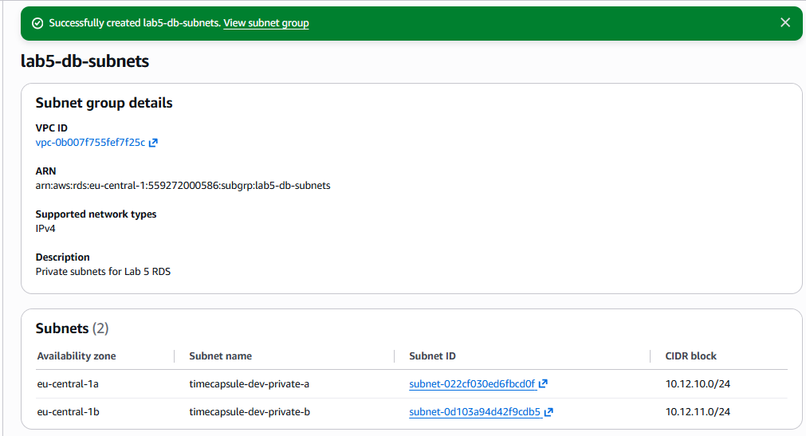

Рисунок 1 - Группа подсетей RDS с двумя приватными подсетями в разных зонах доступности

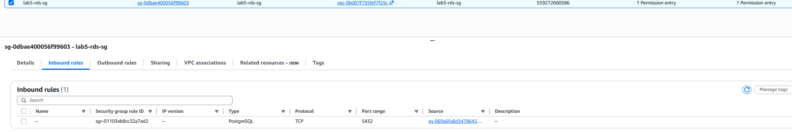

Рисунок 2 - Security Group базы данных с доступом по порту 5432 только от Security Group веб-сервера

### Ответ на вопрос

**Почему для ограничения доступа удобнее использовать Security Group источника, а не его IP-адрес? Зачем указывать две подсети, если учебная база будет работать в одной зоне?**

Security Group удобнее использовать, потому что IP-адрес сервера может измениться, а правило доступа продолжит работать.

Две подсети в разных зонах нужны, чтобы при необходимости можно было разместить базу в другой зоне. Сейчас наша база работает только в одной зоне.

## Задание 2. База RDS

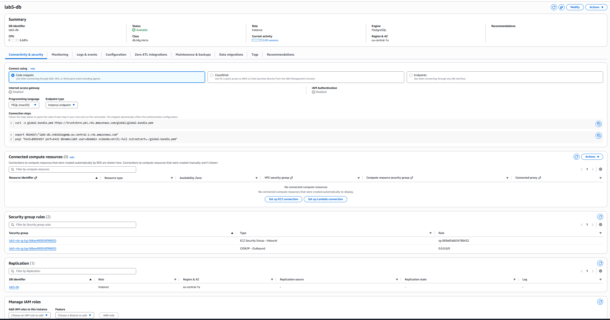

Рисунок 3 - Конфигурация учебной базы Amazon RDS

### Ответ на вопрос

**Как убедиться, что база принимает подключения только с нужного сервера? Почему для неё выбрана зона `eu-central-1a`? От чего защищает `deletion protection`, а от чего нет?**

Нужно проверить, что публичный доступ отключён, а в Security Group разрешён порт 5432 только от сервера приложения. Дополнительно можно проверить подключение с разрешённого сервера и недоступность базы извне.

Зона `eu-central-1a` выбрана по условию задания. `Deletion protection` защищает экземпляр RDS от случайного удаления, но не защищает от удаления таблиц или строк SQL-запросами.

## Задание 3. Подключение к базе

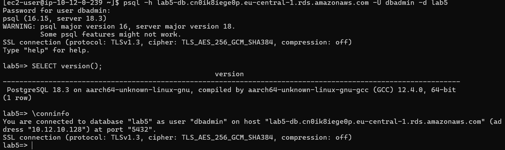

Рисунок 4 - Проверка соединения с RDS командой \conninfo

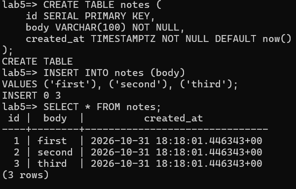

Рисунок 5 - Таблица notes с записями first, second и third

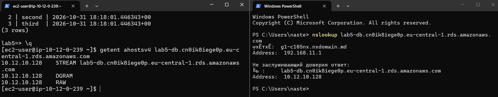

Рисунок 6 - Проверка приватного IP-адреса Amazon RDS

## Задание 4. Реплика для чтения

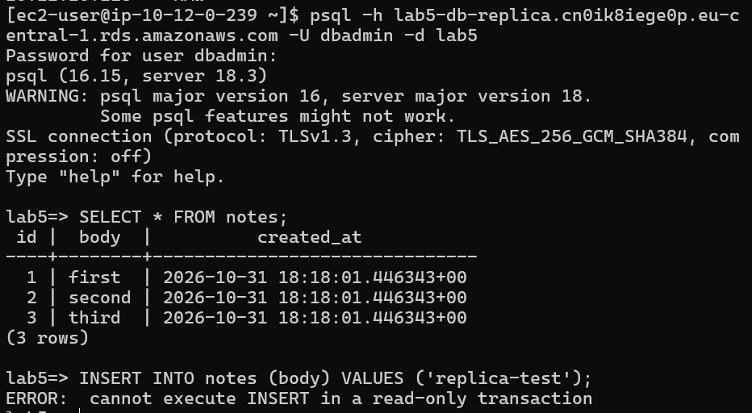

Рисунок 7 - Ошибка выполнения INSERT на реплике

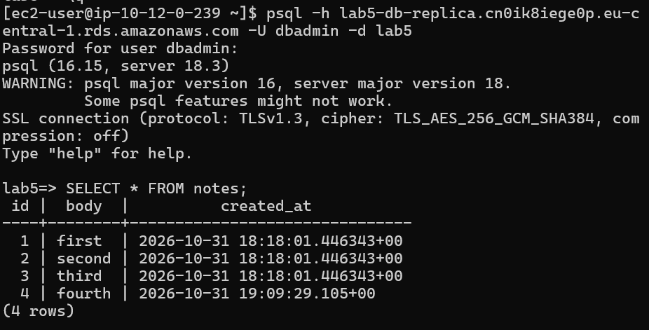

Рисунок 8 - Строка fourth на реплике после добавления в основную базу

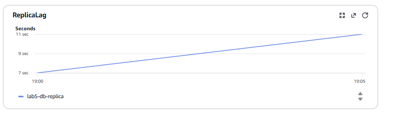

Рисунок 9 - Метрика задержки репликации ReplicaLag

### Ответ на вопрос

**Почему `INSERT` на реплике не выполнился? Чем реплика для чтения отличается от резервного экземпляра Multi-AZ?**

`INSERT` не выполнился, потому что реплика работает в режиме только для чтения. Изменения на неё поступают из основной базы.

Read Replica используется для распределения нагрузки на чтение. Multi-AZ предназначен для повышения доступности базы и автоматического переключения на резервный экземпляр при отказе основной зоны.

## Задание 5. Восстановление после ошибки

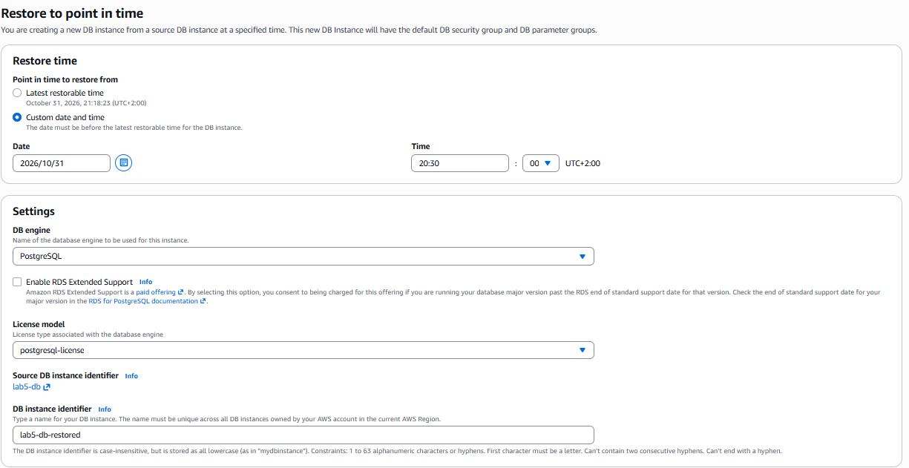

Рисунок 10 - Настройка восстановления базы на выбранный момент времени

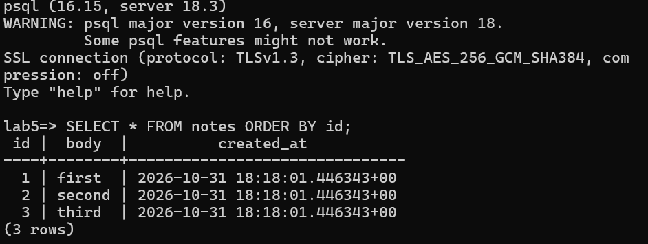

Рисунок 11 - Проверка записей после восстановления базы

### Ответ на вопрос

**Почему реплика не спасла данные? Почему восстановление создаёт новую базу, а не откатывает старую?**

Реплика получает изменения основной базы, включая ошибочное удаление данных. Поэтому она не заменяет резервное копирование.

Point-in-Time Restore создаёт новый экземпляр с состоянием данных на выбранный момент времени. Исходная база при этом сохраняется, что позволяет проверить восстановленные данные перед дальнейшими действиями.

# Часть 2. Продвинутый уровень

## Задание 6. База приложения

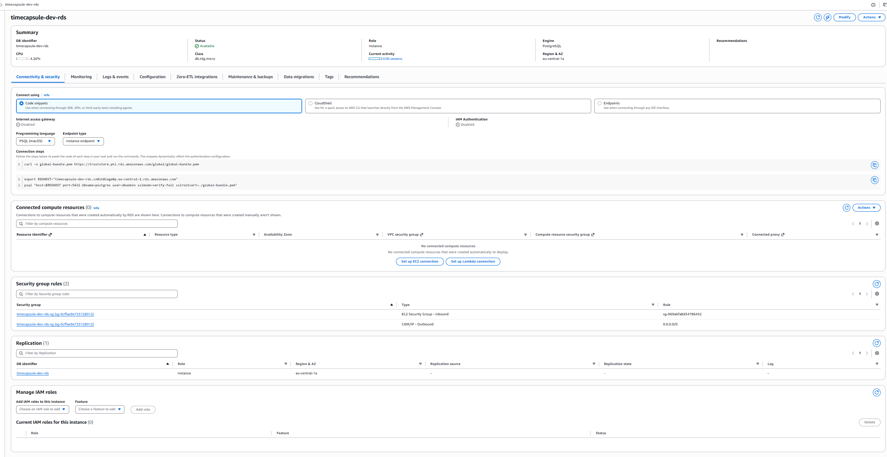

Рисунок 12 - Подключение и параметры безопасности Amazon RDS для TimeCapsule

### Ответ на вопрос

**Какие параметры базы приложения вы выбрали бы иначе для рабочей системы с реальными пользователями? Почему?**

Для рабочей системы выбрала бы Multi-AZ, чтобы обеспечить автоматическое переключение на резервную базу при отказе зоны. Класс экземпляра подбирала бы по реальной нагрузке. Также настроила бы мониторинг, уведомления об ошибках и регулярную проверку восстановления данных. Автоматическую ночную остановку для постоянно доступного приложения не использовала бы.

## Задание 7. Ночная остановка базы

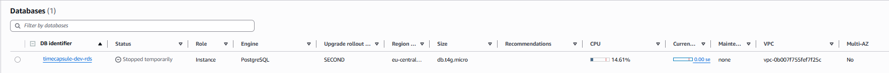

Рисунок 13 - Автоматическая остановка RDS через EventBridge Scheduler

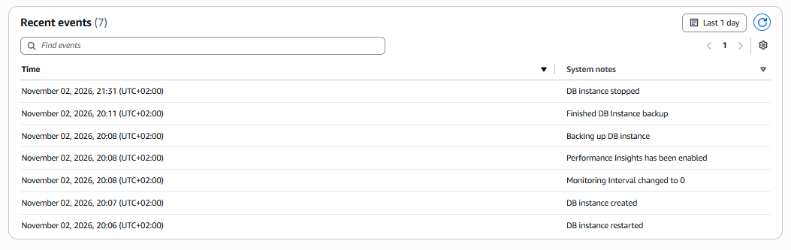

Рисунок 14 - Событие остановки базы в журнале Amazon RDS

### Ответ на вопрос

**Зачем расписанию своя роль, если вы и сами можете остановить базу? Почему роль может остановить только одну базу?**

EventBridge Scheduler выполняет действия автоматически, поэтому ему нужна собственная IAM-роль с необходимыми разрешениями.

Политика разрешает действие `rds:StopDBInstance` только для ARN базы `timecapsule-dev-rds`. Поэтому эта роль не может останавливать другие базы данных.

## Задание 8. Пользователь и база данных

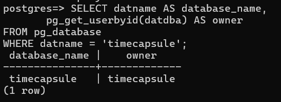

Рисунок 15 - Проверка создания базы данных timecapsule и назначения владельца

### Ответ на вопрос

**Почему приложению нужен отдельный пользователь, а не `dbadmin`?**

Для приложения лучше использовать отдельного пользователя с необходимыми правами. `dbadmin` предназначен для администрирования базы.

Использование отдельной учётной записи снижает риски при ошибках приложения или компрометации его пароля.

## Задание 9. Перенос данных

Данные старой базы PostgreSQL на EC2 выгружены через `pg_dump` и загружены в Amazon RDS.

После переноса выполнено сравнение количества записей в таблицах `users` и `capsules`.

| Таблица | Старая база EC2 | Новая база RDS |
|---|---:|---:|
| users | 2 | 2 |
| capsules | 4 | 4 |

Количество записей полностью совпало. Файл выгрузки `timecapsule.sql` удалён, поскольку содержал хеши паролей пользователей.

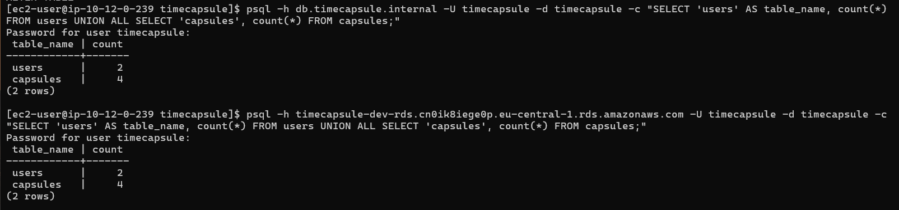

Рисунок 16 - Сравнение количества пользователей и капсул до и после миграции

## Задание 10. Переключение приложения

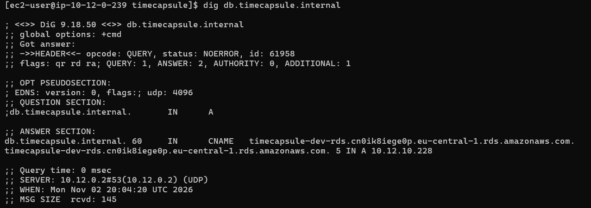

Рисунок 17 - Проверка DNS-записи `db.timecapsule.internal` через dig

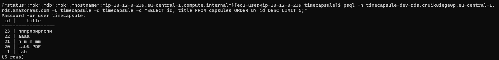

Рисунок 18 - Новая капсула в Amazon RDS после переключения приложения

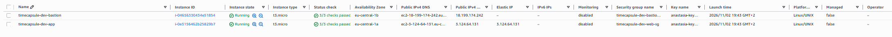

Рисунок 19 - Список EC2-серверов после удаления старого сервера PostgreSQL

### Ответ на вопрос

**Почему не пришлось менять `DB_HOST`? Какие обязанности из ЛР3 перешли к AWS, а какие остались за вами?**

Приложение продолжило использовать адрес `db.timecapsule.internal`. Изменилась только DNS-запись в Route 53, поэтому значение `DB_HOST` осталось прежним.

AWS теперь отвечает за инфраструктуру базы данных, обслуживание PostgreSQL и автоматические резервные копии. За структуру данных, права пользователей, безопасность приложения и правильность миграции продолжаем отвечать мы.

## Задание 11. Обслуживание базы

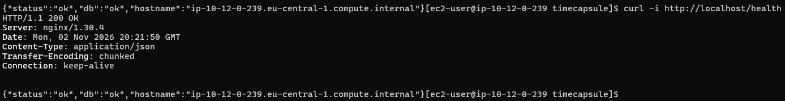

Рисунок 20 - Проверка доступности приложения во время перезагрузки RDS

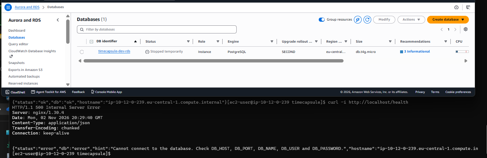

Рисунок 21 - Ошибка подключения приложения при остановленной Amazon RDS

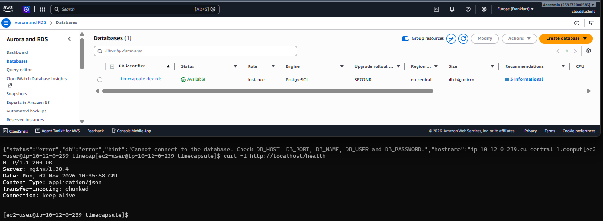

Рисунок 22 - Восстановление подключения приложения после запуска RDS

### Проверка CloudTrail

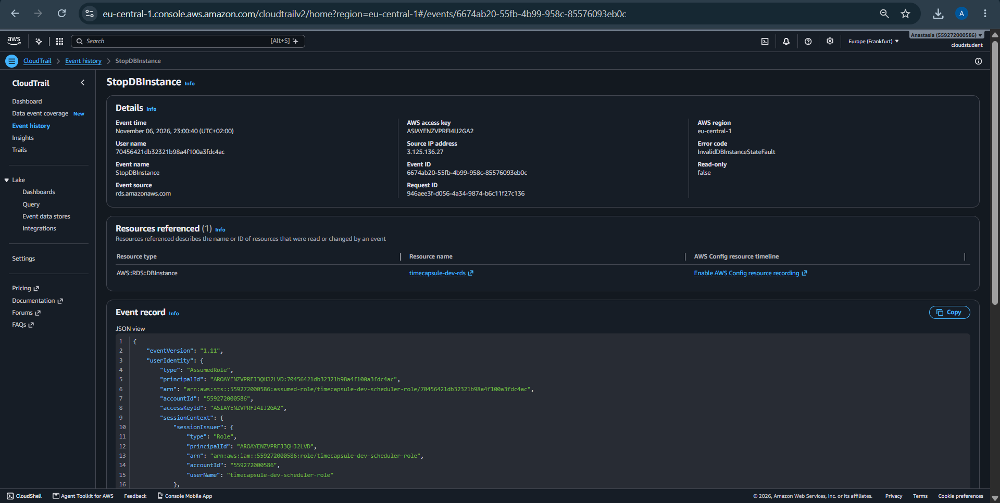

Рисунок 23 - Событие StopDBInstance в AWS CloudTrail

### Ответ на вопрос

**Что показывал `/health` во время перезагрузки? Изменился ли endpoint после остановки и запуска? Какую ошибку получает расписание, если база уже остановлена?**

Во время выполненных проверок при перезагрузке `/health` возвращал `HTTP 200 OK` и `"db":"ok"`.

Когда база была полностью остановлена, приложение возвращало `HTTP 500` и ошибку подключения к базе. После запуска работа восстановилась.

Изменение endpoint после остановки и запуска отдельно не проверялось. Повторный вызов остановки для уже остановленной базы может завершиться ошибкой состояния экземпляра, но результат такого вызова в лабораторной не проверялся.

## Задание 12. Архитектура и решение

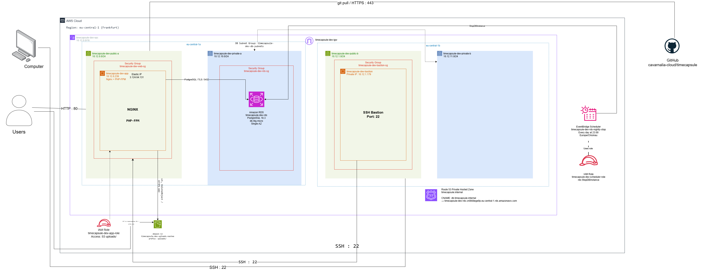

Рисунок 24 - Архитектура TimeCapsule после переноса PostgreSQL в Amazon RDS

### ADR

[Решение о размещении базы данных](../adr/0004-database-hosting.md)

# Контрольные вопросы

## 1. Как проходит запрос от браузера до базы? Какие проверки проходит соединение на каждом шаге?

Браузер отправляет запрос на веб-сервер EC2, где работает приложение TimeCapsule. Приложение проверяет данные запроса и права пользователя.

Для подключения к базе используется адрес `db.timecapsule.internal`, который через Route 53 указывает на RDS. Security Group разрешает подключение по порту 5432 только от сервера приложения. PostgreSQL проверяет учётные данные пользователя `timecapsule` и его права доступа к данным.

## 2. Чем репликация отличается от резервного копирования?

Репликация передаёт изменения из основной базы в копию. Если в основной базе случайно удалить данные, удаление может повториться и на реплике.

Резервное копирование позволяет восстановить данные на более ранний момент времени. Поэтому репликация помогает распределять нагрузку и повышать доступность, но не заменяет резервные копии.

## 3. Как пережить отказ зоны `eu-central-1a` и сколько это будет стоить?

В текущей конфигурации используется Single-AZ, поэтому автоматического переключения на другую зону нет.

Для защиты от отказа зоны можно использовать RDS Multi-AZ. Резервный экземпляр находится в другой зоне, и AWS может автоматически переключить базу на него.

Такое решение дороже Single-AZ из-за дополнительных ресурсов. Точная стоимость зависит от конфигурации и рассчитывается отдельно.

## 4. Как вы решили проблему автоматического запуска базы через 7 дней?

Настроено ежедневное расписание EventBridge Scheduler на 23:00 по часовому поясу Europe/Chisinau.

Расписание вызывает действие `StopDBInstance` для `timecapsule-dev-rds`.

Если AWS автоматически запустит базу после семи дней остановки, расписание сможет снова остановить её при следующем успешном выполнении.

Таким образом ограничивается время работы экземпляра и снижаются расходы. Хранение данных при этом продолжает оплачиваться.

