# Лабораторная работа №6.  Масштабирование и балансировка нагрузки. Elastic Load Balancing, Amazon EC2 Auto Scaling

**ФИО:** Каварналы Анастасия  
**Группа:** IA2403  
**Специальность:** Прикладная информатика  
**Уровень:** Продвинутый  
**Репозиторий:** https://github.com/cavarnalia-cloud/timecapsule

# Часть 1. Базовый уровень

## Задание 1. Балансировщик

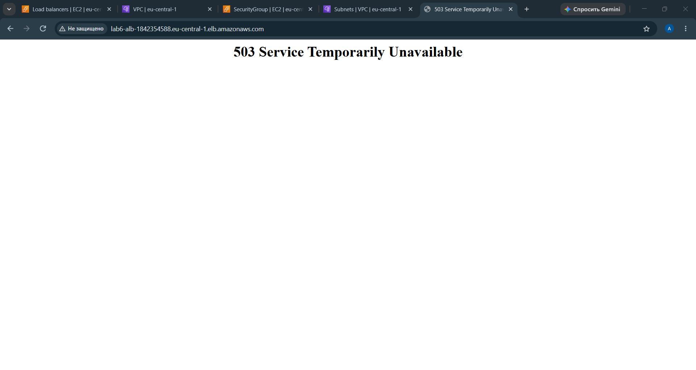

Рисунок 1 - Ответ Application Load Balancer 503 до появления доступных серверов

### Ответ на вопрос

**Какой ответ вернул балансировщик и почему? Зачем ему подсети в двух зонах?**

Балансировщик вернул ошибку 503 Service Unavailable, потому что в целевой группе ещё не было исправных серверов, которым можно передать запрос. Подсети в двух зонах доступности нужны, чтобы балансировщик продолжал работать, если одна из зон станет недоступна.

## Задание 2. Группа Auto Scaling

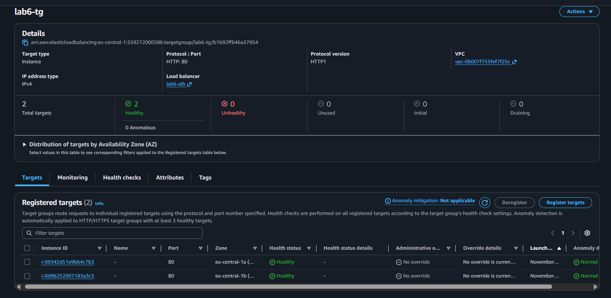

Рисунок 2 - Две исправные цели в Target Group

Рисунок 3 - Ответ от первого EC2-сервера через балансировщик

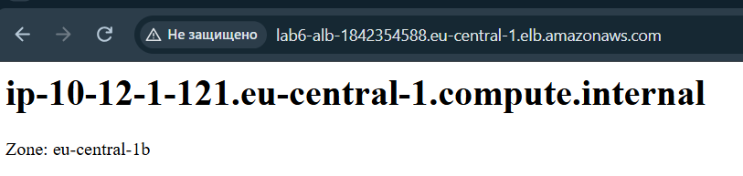

Рисунок 4 - Ответ от второго EC2-сервера через балансировщик

### Ответ на вопрос

**Чем группа Auto Scaling отличается от целевой группы? Почему в шаблоне нет подсети?**

Auto Scaling Group создаёт и удаляет EC2-серверы и поддерживает нужное их количество. Target Group хранит список серверов, на которые балансировщик может отправлять запросы. Подсеть не указывается в Launch Template, потому что нужные подсети выбираются самой Auto Scaling Group.

## Задание 3. Нагрузка

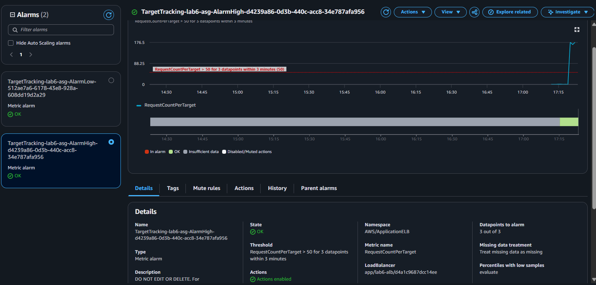

Рисунок 5 - Метрика RequestCountPerTarget во время нагрузки

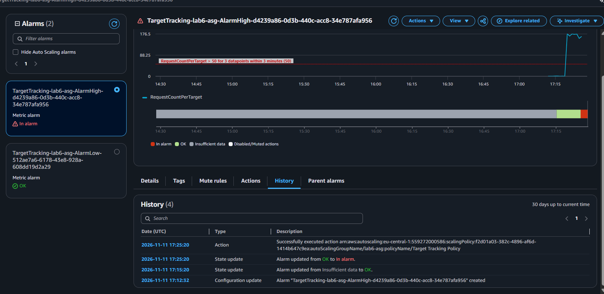

Рисунок 6 - Срабатывание тревоги CloudWatch при высокой нагрузке

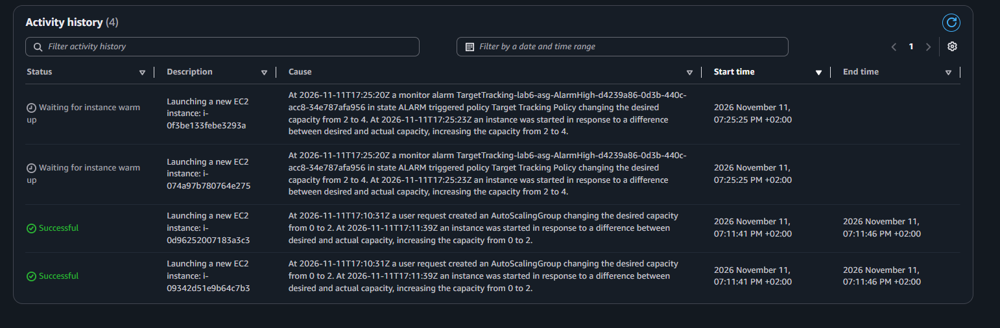

Рисунок 7 - Увеличение количества EC2-серверов Auto Scaling Group

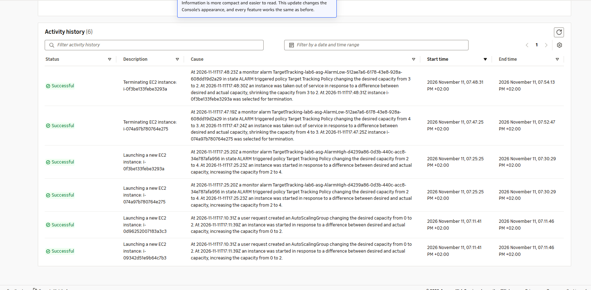

Рисунок 8 - Уменьшение количества EC2-серверов политикой Target Tracking после снижения нагрузки

### Ответ на вопрос

**Сколько серверов запустила группа и почему не больше четырёх? Почему метрика упала после запуска новых серверов, хотя запросов не стало меньше? Почему группа добавляет серверы быстрее, чем убирает?**

Группа увеличила количество серверов до четырёх, потому что максимальный размер Auto Scaling Group был установлен равным 4. После запуска дополнительных серверов запросы распределились между большим количеством экземпляров, поэтому число запросов на один сервер уменьшилось. Серверы добавляются быстрее, чтобы быстро обработать рост нагрузки, а удаляются осторожнее, чтобы не уменьшить мощности слишком рано.

# Часть 2. Продвинутый уровень

## Задание 4. Сессии в DynamoDB

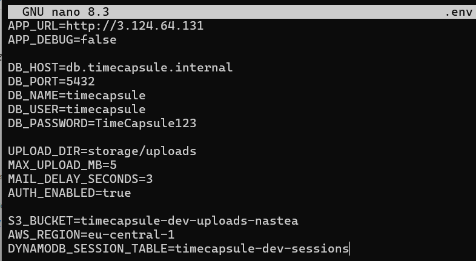

Рисунок 9 - Настройка DynamoDB для хранения сессий приложения

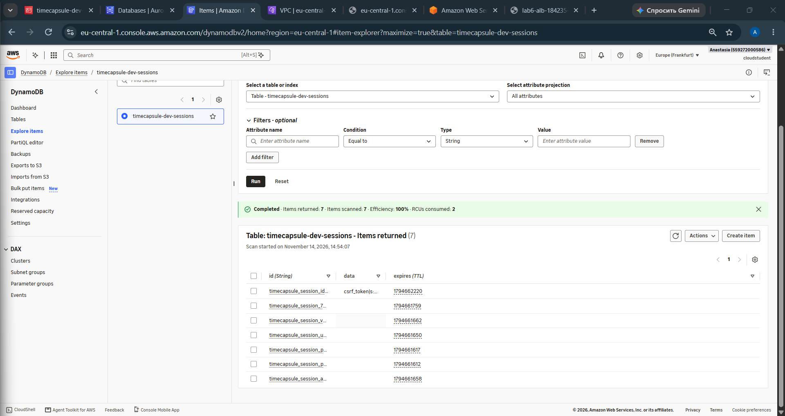

Рисунок 10 - Сессия пользователя в таблице DynamoDB

### Ответ на вопрос

**Почему сессии нельзя оставить в файлах, когда серверов несколько? Зачем Node.js нужен `initialized: true`?**

Если сессия хранится в файле конкретного сервера, другой сервер не сможет её прочитать, и пользователь может потерять авторизацию при переключении между серверами. Хранение сессий в DynamoDB делает их общими для всех экземпляров. В варианте Node.js параметр `initialized: true` сообщает библиотеке, что таблица DynamoDB уже создана и создавать её повторно не нужно.

## Задание 5. Приложение в группе Auto Scaling

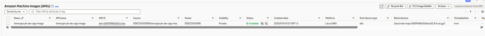

Рисунок 11 - AMI-образ приложения в состоянии Available

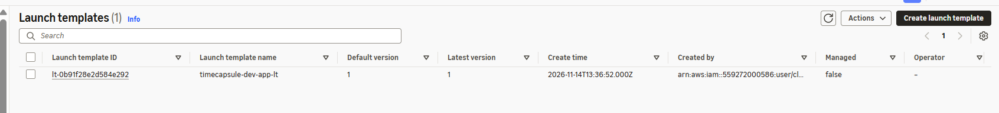

Рисунок 12 - Launch Template для серверов приложения

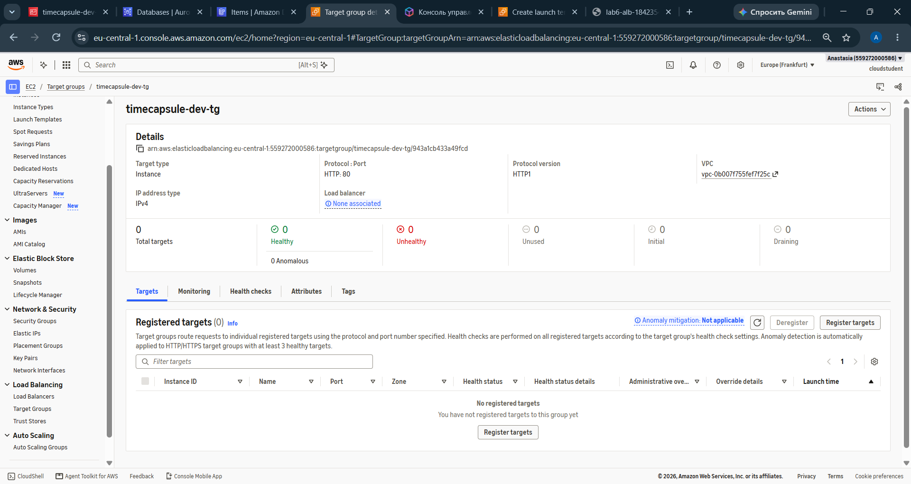

Рисунок 13 - Target Group приложения

Рисунок 14 - Работа приложения через первый сервер Auto Scaling Group

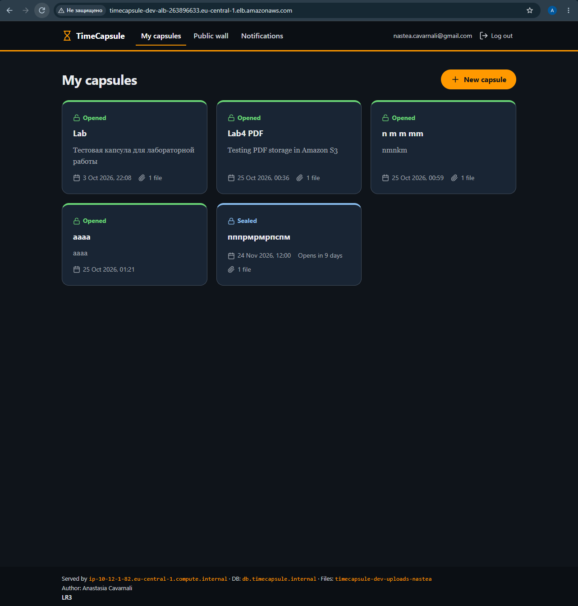

Рисунок 15 - Работа приложения через второй сервер Auto Scaling Group

### Ответ на вопрос

**Почему Elastic IP больше не нужен? Почему у всех серверов группы одинаковые `.env` и секреты? Что станет с проверкой `/health`, если базу остановить?**

Elastic IP больше не нужен, потому что пользователи обращаются к Application Load Balancer по его DNS-имени, а не напрямую к одному EC2-серверу. Серверы группы создаются из одного AMI-образа, поэтому получают одинаковую конфигурацию приложения и `.env`. Если база данных перестанет работать, проверка `/health` не сможет подтвердить доступность базы и сервер будет считаться нездоровым.

## Задание 6. Нагрузка на приложение

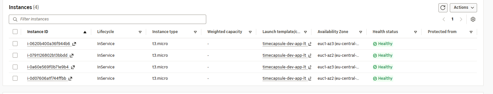

Рисунок 16 - Увеличение Auto Scaling Group до четырёх серверов

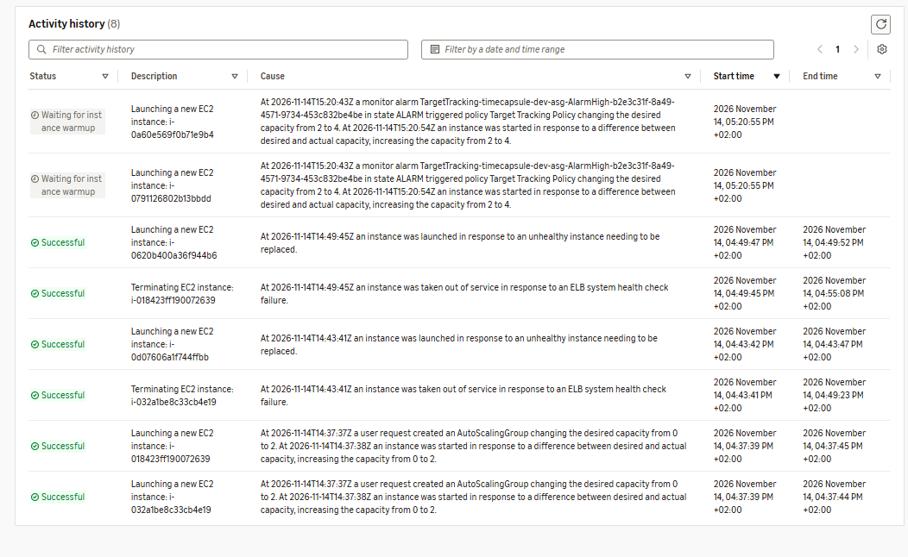

Рисунок 17 - Запуск дополнительных серверов политикой Target Tracking

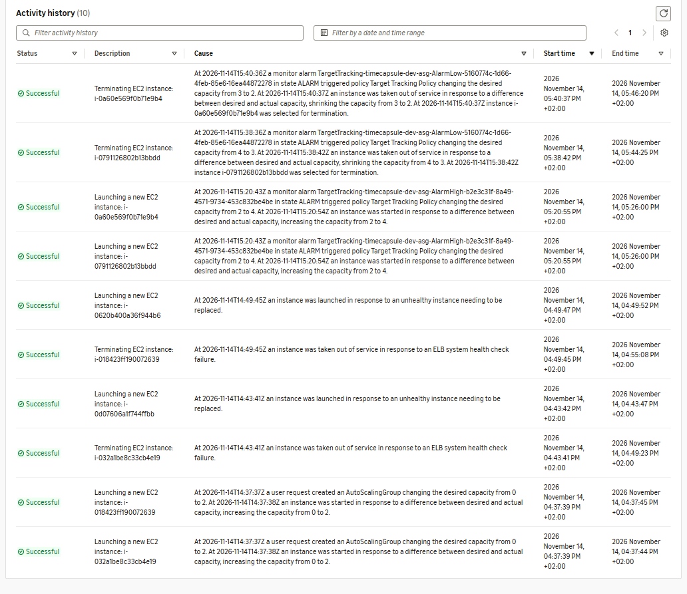

Рисунок 18 - Возврат Auto Scaling Group к двум исправным серверам

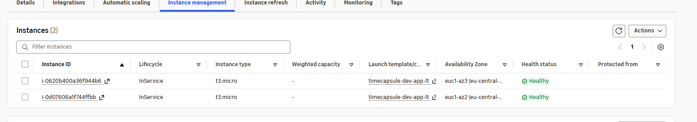

Рисунок 19 - Уменьшение количества серверов с четырёх до двух

### Ответ на вопрос

**Пришлось ли входить заново, когда группа добавляла или удаляла серверы? Почему?**

Нет, повторно входить не пришлось. Сессия пользователя хранится в DynamoDB и доступна всем серверам группы, поэтому авторизация сохраняется независимо от того, какой EC2-сервер обработал запрос.

## Задание 7. Архитектура и решение

### ADR

[Решение о размещении базы данных](../adr/0005-database-hosting.md)

# Контрольные вопросы

## 1. Как проходит запрос от браузера до базы и таблицы сессий?

Браузер отправляет запрос на DNS-адрес Application Load Balancer. Балансировщик выбирает один из исправных EC2-серверов Auto Scaling Group и передаёт ему запрос. Сервер приложения обрабатывает запрос и при необходимости обращается к Amazon RDS PostgreSQL за основными данными приложения, к Amazon DynamoDB за пользовательской сессией и к Amazon S3, если нужно получить или сохранить вложение. После обработки сервер возвращает ответ через Load Balancer обратно в браузер.

## 2. Чем проверка балансировщика отличается от проверки группы Auto Scaling?

`Load Balancer` выполняет health check, чтобы определить, может ли конкретный сервер принимать пользовательские запросы. Если сервер не проходит проверку, `балансировщик` перестаёт направлять на него трафик. `Auto Scaling Group` использует состояние экземпляров и health checks, чтобы решить, нужно ли заменить неисправный EC2-сервер или изменить количество серверов. То есть `балансировщик` отвечает за распределение трафика, а `Auto Scaling Group` - за количество и состояние EC2-серверов.

## 3. Что произойдёт при отказе зоны `eu-central-1a`?

EC2-серверы в зоне `eu-central-1a` станут недоступны. Load Balancer сможет направлять запросы на исправные серверы в другой зоне, например eu-central-1b, а Auto Scaling Group сможет поддерживать необходимое количество экземпляров в доступных зонах. Однако используемая Amazon RDS PostgreSQL работает в режиме Single-AZ и находится в eu-central-1a, поэтому при отказе этой зоны база данных может стать недоступной. В результате приложение не сможет нормально работать с данными, даже если EC2-серверы в другой зоне продолжат работать. Для автоматического переключения базы на другую зону нужно использовать RDS Multi-AZ.
